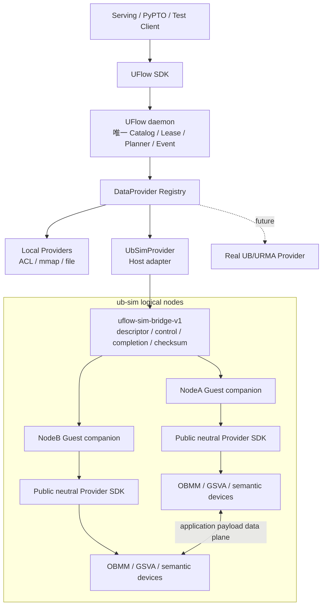

# PhaseC-02：UFlow 统一 DataProvider、ub-sim Guest Bridge 与首条跨节点 DDR 验证

> 开发环境统一口径（2026-08-31）：实现、构建和验证固定在 `ssh serving-b` → `openeuler-2403-DS` 内执行；容器用户为 `root`，workspace 根目录为 `/home/sj`。当前内部可行 ub-sim 基线固定为 `/home/sj/git/ub_sim@c68cfb8ab139312cc9d41fb26f0ebcd3b00c7072`，UFlow 仓库入口为 `/home/sj/git/data-service`。实际运行使用 `/home/sj/phasec02_runs/<run_id>/` 隔离配置、overlay、日志和证据，不修改 canonical ub-sim/mem-service 源码，不覆盖 dirty 的远端 data-service checkout。详见 [Phase0-development-environment.md](Phase0-development-environment.md) 与 [PhaseC-01-ub-sim-upstream-sync-and-selftest.md](PhaseC-01-ub-sim-upstream-sync-and-selftest.md)。

Last reviewed: 2026-09-01

Status: `closed-internal / provider-framework-ready / ub-sim-cross-node-ddr-validation-ready / formal-archive-promoted`

## 0. 2026-09-01 最终闭环结果

PhaseC-02 已完成实现、三仓独立提交、正式归档、C01 exact-commit 回归和最终双节点验收。权威证据为：

```text
remote: /home/sj/phasec02_runs/phasec02_uflow_ub_sim_20260901_real13/evidence/
local:  data-service/results/phasec02_uflow_ub_sim_20260901_real13/
promotion: data-service/results/phasec02_promotion_20260901/
host:   serving-b / openeuler-2403-DS / root
data-service: c429d16e1b0e92570e65a386bc76433058b972c3
ub_sim:      b624ee4318c082434ede1415e9e4d558ca47abe3
mem_service: 546caede8cbfe79c28c38e3659938e02f39bd953
```

三份提交均保存为经过 `git bundle verify` 的 complete-history 正式归档；ub_sim 的 mem_service gitlink 与 guest lock 原子指向 `546caed`。C01 在精确提交上 U0～U4 全部 PASS，状态为 `last-known-good / repaired / ready=true`：`repaired` 表示它是离线 downstream archive 而非 upstream branch tip，不否定内部验收。远端 canonical `/home/sj/git/ub_sim@c68cfb8` 及其 `mem_service@366a335` 全程 clean/unchanged。

本轮已交付：

- UFlow 统一 `DataProvider`、provider registry、typed provider identity/capability/resource/descriptor/access/completion/error 合同；
- `DataObject / Placement / ResourceBinding / AccessBinding / Handle` 分层，NodeB remote map 只创建 AccessBinding，不创建第二个 Placement；
- Host `UbSimProvider`、`uflow-sim-bridge-v1`、每 Guest companion、独立 virtio-serial 通道和 run-owned initramfs overlay；
- public OBMM SDK/library 的安装消费、Guest 内 allocate/seed/publish/import/checksum/revoke/release；
- Python `uflow.sim("ub_sim")` API、descriptor-only handle、typed 三步 Plan/四 Event、Trace/Monitor 关联和一键编排；
- bridge/control capture、payload/canary 扫描、external source before/after、精确 PID cleanup 和完整 `SHA256SUMS`。

最终 golden slice 结果：

| 验收项 | real13 结果 |
|---|---|
| 固定场景 | 2 logical nodes；NodeA.DDR；NodeB read-only；offset 0；4096 bytes |
| UFlow identity | object `100`；placement `10000`；resource binding `40000`；access binding `50000` |
| Placement 语义 | `placement_count=1`；`remote_map_created_placement=false` |
| 数据正确性 | NodeA seed 与 NodeB observed checksum 均为 `18252992797487244163` |
| Plan/Event | plan `20000`；3 个 provider steps；4 个 events；parent terminal 恰好 1 个 |
| 生命周期 | Host 解引用拒绝；revoke 后旧 AccessBinding stale 并拒绝读取 |
| Trace/Monitor | 21 个 trace events；object/binding/plan/event/provider/session/node/fidelity 均可关联 |
| payload 扫描 | Host control/bridge `0`；unexpected `0`；ub-sim FM ring `28` 次命中 |
| 回归 | Rust workspace 22 tests PASS；Monitor/PhaseC Python 16 tests PASS；Trace Python 10 tests PASS |
| 清理与完整性 | daemon/QEMU 均退出；canonical external source unchanged；SHA256 全量校验 PASS |

payload 扫描中的 28 次命中只位于 ub-sim 的 FM ring，它是 simulator 数据面 backing，等价于仿真设备/链路承载数据；不能把它计入 Host control-plane 旁路，也不能声称整个 run-root 对 payload 全局零命中。真正的关闭条件是 bridge、daemon control 和其他 Host ordinary artifact 为零命中，同时 simulator data-plane 命中被单独分类并留证。

本文 DoD 已按内部正式归档口径关闭，状态升级为 `provider-framework-ready / ub-sim-cross-node-ddr-validation-ready / formal-archive-promoted`。它仍不是 upstream/release-ready；real13 只证明固定 2-node、只读、4 KiB 单 range 的 functional slice，不得据此声明通用 remote DDR、动态 topology-aware routing 或真实 remote HBM 已完成。

## 1. 任务定位

PhaseC-02 建立 UFlow 的统一后端合同和第一条 ub-sim 功能通路。它不是为 simulator 另建一套对象和传输系统，也不在首版覆盖所有 node/device 组合。

本任务只要求闭环：

```text
4 KiB deterministic DataObject
  Placement = NodeA.DDR
  access_kind = remote_map
  transport_kind = ub_shmem/obmm_gsva
    -> OBMM publish/export
    -> NodeB import/map/read
  checksum + completion + revoke/stale
```

Phase C 的最终目标仍是验证不同 logical node、不同 semantic device 间的多条数据通路、拓扑选路和故障行为；该完整矩阵在 C04～C08 逐步收齐。C02 首版不要求跨设备完整矩阵，也不以 remote HBM 为关闭条件。

C02 的 validation slice 边界固定为：`2 logical nodes / NodeA 单 producer / NodeB 单只读 importer / 4096 bytes / offset=0 的单一连续 range / 单次 publish-import-read-revoke`。任意大小和多 range、NodeB write、通用 publish/read/write、权限矩阵、一致性策略、多 client/多 importer 生命周期以及真正 copy/replica 均属于 C04；C02 不得提前形成第二套简化语义。

C02 的核心交付是：

1. 把 UFlow 当前 object 与本机 ACL/mmap/file 资源解耦；
2. 建立 physical、simulated 和未来真实 UB 共用的 `DataProvider` 合同与 registry；
3. 实现 Host `UbSimProvider`、versioned control bridge 和 per-QEMU-Guest companion；
4. 用 UFlow SDK、Catalog、Plan、Event、Trace 和 Monitor 驱动一条无 payload 旁路的跨节点 DDR remote-map 通路；
5. 为 C03 topology/capability、C04 remote DDR、C05 SSD/SSU、C06 routing 和 C07 failure/replan 提供稳定 schema。

一句话目标：

> 用一条最小但真实的跨节点 DDR/OBMM 数据通路证明 UFlow 的统一对象、provider、descriptor、completion 和可观测合同成立，同时保证后续真实 UB provider 无需重写上层模型。

## 2. 架构决策

### 2.1 DataProvider 是统一扩展点

`UbSimProvider` 是通用 `DataProvider` 的一种实现，不新建与 physical provider 平行的 `SimulationBackend` 世界：

```text
DataProviderRegistry
  ├── LocalAclProvider       physical HBM
  ├── LocalDdrProvider       physical DDR
  ├── LocalSsdProvider       physical SSD
  ├── MockProvider           contract test
  ├── UbSimProvider          simulated UB/DDR/SSD/semantic HBM
  └── FutureUrmaProvider     physical remote UB
```

故障注入、虚拟 cost profile、virtual time、session reset 等仿真专有操作通过可选 `SimulationControl` 扩展提供。Planner、Catalog、DataObject、TransferPlan 和 TransferEvent 不依赖该扩展。

### 2.2 同一业务语义，不同 execution realm

physical 与 simulated 共享：

- DataObject identity、version、consistency；
- Placement、Lease、Handle；
- Plan、PlanStep、Event；
- namespace、role、shape、dtype、range 和 checksum；
- Trace/Monitor 的对象、路径和事件关联。

二者必须显式区分：

```text
execution_mode = physical | simulated
provider_id
provider_kind = local | remote | simulator
execution_realm_id
requested_fidelity
actual_fidelity = physical | functional | semantic
addressability
limitations[]
```

规则：

- `execution_mode` 是 request/placement 约束，不进入 DataObject identity；
- `medium=hbm|ddr|ssd` 表达 C02 使用的逻辑驻留 tier，不表达硬件保真度；
- C02 中 `medium=ddr` 表示数据真实驻留在 NodeA DDR；`access_kind=remote_map`、`transport_kind=ub_shmem` 表示 NodeB 的访问方式；
- 当前 OBMM/GSVA 映射不得另记为 `medium=ub_shmem`。只有未来存在独立、真实驻留的 UB shared-memory pool 时，才可经单独架构审查启用 `UB_SHMEM` medium；
- 不增加 `sim_hbm`、`fake_ddr` 等平行介质；
- physical 与 simulated placement 默认属于不同 realm；
- 没有显式 cross-realm bridge capability 时，不得在两个 realm 之间 plan/transfer，也不得声称数据同步；
- 同一个 ub-sim run 只有一个 `execution_realm_id=ub_sim:<run_id>`；NodeA/NodeB 位于同一 realm，但分别拥有自己的 `provider_session_id`、`boot_id` 和 `session_generation`；
- Guest reboot 只使该 node 的 session/binding/access view stale，不会把同一 run 的其他 node 自动划入新 realm；
- simulated result 必须携带 `simulated/semantic` truth label，禁止外推物理容量、带宽、延迟、DMA 或 cache 行为。

### 2.3 UFlow 是唯一业务真相

UFlow 拥有：

- business object_id、placement_id、lease_id；
- object version、readiness、owner 和 consistency；
- 路由策略、plan、event、fallback/replan；
- Trace、Monitor 和验收证据关联。

ub-sim/mem-service 的 object_id、region_handle、mapping_handle、completion_id 只作为 provider resource reference，不得替代或泄漏为 UFlow object identity。

### 2.4 使用平台，不复制平台

C02 默认不对以下 external canonical source 提交修改：

```text
/home/sj/git/ub_sim
mem_service source/submodule
QEMU UB implementation
guest kernel and existing device models
```

允许：

- 使用固定 revision 的公开 SDK、header、library、CLI、RPC、descriptor 和官方 launcher；
- 在 UFlow 仓库实现 Host adapter、Guest companion 和 bridge protocol；
- 通过 run overlay 将 UFlow-owned companion 注入 Guest；
- 在隔离 build/run 目录链接 external platform 正式发布的公共 SDK/library；
- 对外部 capability 做 version check 和 canary；
- 对缺失能力返回稳定 unsupported/gap。

禁止：

- 把 mem-service/OBMM 私有源码复制或 vendor 到 UFlow；
- 让 mem-service object daemon 成为第二套 Catalog；
- 解析 console `PASS` 文本伪造业务 completion；
- 用 Host memcpy、临时 payload 文件或 control RPC 搬运 application payload；
- simulated request 自动 fallback 到 LocalProvider；
- 为通过 C02 而直接修改 canonical ub-sim/mem-service checkout。

如果 external public surface 不足，必须建立独立 upstream enablement 任务。上游变更形成可获取 clean commit、更新 ub-sim gitlink/lock并重新通过 C01 后，C02 才能继续相应 Gate。

## 3. 当前外部接口事实与启动判断

### 3.1 已确认事实

针对 `/home/sj/git/ub_sim@c68cfb8` 的只读审计结论：

- mem-service public daemon wire 提供 object/KV/artifact/admin 等业务操作；
- public daemon wire 当前没有通用 OBMM region `register/export/import/map/publish/poll/release` 操作；
- `mem_service_provider.h` 是 Guest/进程内中立 C Provider 合同；
- OBMM Provider 能力当前主要由 Guest app/conformance 程序按源码构建使用；
- OBMM Provider 尚未以可直接供 UFlow Guest companion 消费的稳定安装库/SDK 形式交付；
- QMP 负责 QEMU 生命周期；现有 console/serial log 主要负责 app bootstrap、诊断和测试判定，不是稳定数据管理 RPC；
- 已有 OBMM conformance 能证明 provider 语义，但不能替代 UFlow 发起的对象、plan、event 和 checksum 闭环。

### 3.2 当前决策

纯 Host-only 黑盒 UbSimAgent 无法完成 C02 数据闭环。当前首选架构固定为：

```text
Host UFlow daemon
  -> Host UbSimProvider
  -> dedicated versioned UFlow bridge
  -> per-QEMU-Guest UFlow companion
  -> public mem-service neutral Provider SDK/library
  -> OBMM/GSVA data plane
```

Guest companion 不是新的 Catalog daemon。它只：

- 在 Guest address domain 拥有/注册 provider resource；
- 调用公开中立 Provider API；
- 返回 opaque descriptor、completion、checksum、health 和 counter；
- 执行 release/revoke；
- 不创建 UFlow object_id，不决定 placement policy，不解析 serving/model role。

### 3.3 Provider control surface Gate 与 C02-UP0

C02-M0 已确认当前 external baseline 不具备可直接安装和链接的 OBMM Provider library，因此真实 OBMM 数据路径由独立任务 [PhaseC-02-UP0](PhaseC-02-UP0-obmm-provider-library-enablement.md) 解锁。正式路径冻结为：

1. **唯一首选：公共、可安装的 OBMM Provider SDK/library**

   mem-service 正式安装/发布 neutral provider header、OBMM provider library、version manifest 和 link contract；Guest companion 消费该 artifact，不复制源码。

`C02-UP0` 由执行 C02 的 worker 一并负责，但必须在 external 仓库形成独立 clean commit，不能混入 data-service adapter commit。扩大 mem-service daemon RPC 不是 C02/UP0 的备选方案或默认授权；只有公共 library 经证据证明不可行，并经项目总监单独架构复审后才能另立任务讨论。固定 scenario/test app 只能用于 baseline/canary，不能作为长期 UbSimProvider runtime API。

依赖关系的当前状态为：M1～M9 与真实 OBMM integrated acceptance 已在 exact-commit real13 完成；UP0 public surface、external commits、ub_sim gitlink/lock 和 C01 U0～U4 promotion 均已关闭。

## 4. 目标架构与职责



职责：

| 组件 | 权威职责 | 不负责 |
|---|---|---|
| UFlow Catalog | object、placement、binding、lease、version、state | QEMU/OBMM 私有资源布局 |
| Planner/Executor | capability 约束、plan step、event、fallback/replan | simulator 内部设备实现 |
| DataProvider | 统一资源与 transfer/completion 合同 | 业务对象身份和策略 |
| UbSimProvider | Host 侧 platform/session/bridge adapter | Guest pointer、业务 placement policy |
| Guest companion | Guest-local provider resource 和 operation executor | UFlow object identity、全局 route |
| mem-service Provider SDK | neutral region/mapping/completion 语义 | UFlow Catalog |
| ub-sim | logical node/link/device、OBMM/GSVA、故障模型 | 生产能力与物理性能声明 |

QMP 只用于 Guest pause/resume/shutdown；console 只用于 bootstrap/诊断。业务 descriptor/completion 使用独立 bridge channel。

## 5. 核心数据合同

### 5.1 DataObject、Placement、ResourceBinding、AccessBinding

必须从当前 daemon `Object` 大结构拆分为：

```text
DataObjectRecord
  object_id
  namespace / name / role
  size / shape / dtype
  content_version
  consistency / owner / state

PlacementRecord
  placement_id / object_id
  medium / node_id / device_id / domain
  provider_id / execution_mode / execution_realm_id
  requested_fidelity / actual_fidelity
  addressability
  topology_generation / capability_generation
  range / state

ResourceBindingRecord
  binding_id / placement_id
  provider_id / provider_session_id
  provider_resource_id
  binding_generation
  opaque_descriptor
  allowed_range
  limitations[]
  state

AccessBindingRecord（ImportedView）
  access_binding_id
  placement_id / source_binding_id
  accessor_node_id / accessor_device_id
  accessor_provider_session_id
  source_binding_generation
  access_kind = remote_map
  transport_kind = ub_shmem | obmm_gsva
  addressability = provider_only | remote_mapping
  access_mode / allowed_range
  topology_generation / capability_generation
  state
```

要求：

- 一个 DataObject 可有多个 Placement；
- 一个 realized Placement 有明确 ResourceBinding；
- Placement 只表示数据字节的真实驻留位置或独立副本，不表示“某节点可以远程访问”；
- NodeB import/map NodeA DDR 后只创建 `AccessBinding/ImportedView`，不得创建 NodeB Placement；
- Planner 的 replica/nearest-placement 候选只来自 Placement；AccessBinding 只影响指定 accessor 到源 Placement 的可达性、setup cost 和 path state；
- 只有 provider 真正把完整 range copy/replicate 到 NodeB 独立 resource，并完成 version/checksum/ownership 登记后，才创建 NodeB Placement + ResourceBinding；
- Local ACL allocation、DDR mmap、SSD extent 与 UbSim resource 都使用同一 binding 分层；
- provider-specific descriptor 只由 provider 解析；
- external resource id 不进入 object identity；
- source/accessor provider session restart 后相关 ResourceBinding 或 AccessBinding 必须 stale；
- object content_version 与 binding_generation 不混用。

C02 golden slice 结束时的权威状态必须是：

```text
DataObject X
  Placement P1 = NodeA.DDR                  # 唯一驻留 placement
    ResourceBinding R1 = NodeA OBMM region  # 实际资源
    AccessBinding A1 = NodeB remote view    # 可达性，不是副本
```

### 5.2 DataHandle

```text
object_id / placement_id / binding_id / optional access_binding_id / lease_id
object_version / binding_generation
allowed_range / access_mode / address_domain
execution_mode / execution_realm_id
provider_id / addressability
access_kind / transport_kind
opaque_descriptor
host_dereference
```

simulated/provider-only handle：

- `device_ptr`、`data_ptr`、`as_memoryview`、Host mmap 稳定返回 `HandleNotLocallyAddressable`；
- 不返回 `0` 冒充合法 pointer；
- 不把 Guest VA、GSVA、mapping base 暴露给 Host client；
- range、permission、version、generation 和 lease 必须可验证。

### 5.3 DataProvider v1

通用合同建议拆为以下操作族：

```text
identity()
probe()
capabilities()
health()

submit_operation(ProviderOperation) -> ProviderSubmission
poll_completion(id)
wait_completion(id, timeout)
cancel_completion(id)
read_counters()
```

`ProviderOperation` 至少包含：

```text
Allocate / Release
Publish / Import / Revoke
Checksum
Copy / Read / Write（按 capability）
```

`ProviderSubmission` 必须返回唯一 `provider_completion_id` 和 initial state。即使 external operation 在调用栈内立即完成，也必须通过同一个 completion ID 返回 terminal snapshot；不得同时返回一个同步成功结果、随后再产生第二个 completion。

completion 规则：

- `identity/probe/capabilities/health/read_counters` 是同步只读 query，不创建 TransferEvent；
- 所有 resource mutation 和 data/access operation 统一走 `submit_operation → poll/wait/cancel`；
- 一个 UFlow PlanStep 最多绑定一个 provider completion ID；
- bridge ACK 只表示消息已接收，不是 provider terminal completion；
- step event 只消费该 completion 的状态，parent event 在全部 required step terminal 后只产生一次 terminal outcome；
- unsupported cancel 返回 `CancelUnsupported`，不伪造 canceled；
- `Publish/Import/Revoke` 在 C02 中也遵守这一异步合同，禁止部分实现同步、部分实现另起 event。

provider identity 至少包含：

```text
provider_api_major / provider_api_minor
provider_id / provider_kind
adapter_revision
external_platform_revision
external_protocol_revision
session_id / boot_id
health / ready / degraded_reason
fidelity / limitations[]
```

C02 最小 required capability：

| 操作 | C02 要求 | 说明 |
|---|---|---|
| identity/probe/health | required | version/session/readiness 可验证 |
| DDR allocate | required | NodeA Guest-local owned resource；medium 始终为 DDR |
| publish/export | required | 产生中立 opaque descriptor |
| remote import/map | required | NodeB 建立 bounded AccessBinding/ImportedView，不创建 Placement |
| checksum | required | NodeA seed 与 NodeB view 一致 |
| revoke/release | required | stale generation 负例 |
| unified async completion | required | mutation/access operation 全部走 submit_operation；每 step 唯一 completion |
| cancel | optional | 不支持时返回 `CancelUnsupported` |
| semantic HBM | optional/validation_only | 不作为 C02 Gate |
| SSD/SSU block | not required | C05 |
| full topology discovery | not required | C03；C02 只固定 nodeA/nodeB/session identity |

### 5.4 C02 静态 Topology/Capability Snapshot

C02 冻结 schema，但不实现动态 discovery。每个 run 由受版本管理的 scenario/manifest 生成不可变 snapshot：

```text
topology_snapshot_id = <scenario_sha256>
topology_generation = 1
capability_snapshot_id = <capability_map_sha256>
capability_generation = 1
nodes = [nodeA, nodeB]
execution_realm_id = ub_sim:<run_id>
```

规则：

- C02 Planner/PlanStep 必须引用上述 generation；
- C02 run 期间 scenario、node list、capability map 发生变化时 fail closed，不能递增 generation 后继续；
- provider 只返回自身 identity/session/capability contribution，不承担完整 topology authority；
- C03 再实现动态 `TopologyProvider/CapabilityProvider`、snapshot refresh、generation rollover 和 stale-plan 处理；
- C02 不得因为 schema 中已有 generation 字段而声明 dynamic discovery supported。

### 5.5 SimulationControl 扩展

仅 simulator provider 可选实现：

```text
set_fault_profile
set_cost_profile
reset_session
advance_virtual_time
read_simulator_counters
```

这些操作不得出现在通用 DataProvider required surface，也不得被 serving 业务代码直接依赖。

### 5.6 TransferPlan 与 TransferEvent

Phase C 会出现 relay、多 hop、fallback 和 replan，不能继续只依赖自由文本 `path/engine`。C02 必须冻结 typed plan step：

```text
TransferPlan
  plan_id / request_id
  topology_generation / capability_generation
  execution_realm_id
  steps[]
  cost / explanation

PlanStep
  step_id / dependencies[]
  provider_id / operation
  src_placement_id / optional dst_placement_id / optional access_binding_id
  range
  expected_completion_kind
  fallback_policy
```

Event 至少记录：

```text
event_id / parent_event_id / attempt_id / step_id
plan_id / provider_id / provider_session_id
submitted / queued / running / complete / failed / canceled
planned_path / actual_path
fallback_or_replan_reason
bytes / timestamps / checksum verdict
topology_generation / capability_generation
execution_mode / fidelity
exactly one terminal outcome
```

C02 可以保留当前 `path/engine` 字符串作为兼容输出，但 Planner/Executor 的新行为不能以解析字符串作为权威决策。

### 5.7 稳定错误

至少冻结：

```text
ProviderUnavailable
ProviderNotReady
ProviderVersionMismatch
ProviderOperationUnsupported
ProviderSessionRestarted
ProviderProtocolError
ProviderResourceNotFound
ProviderResourceStale
HandleNotLocallyAddressable
DescriptorMalformed
AccessDenied
RangeOutOfBounds
ChecksumMismatch
QueueFull
Timeout
CancelUnsupported
CrossRealmTransferUnsupported
InternalProviderAdapterError
```

错误 detail 可以包含 external code 和短摘要；UFlow core 不得依赖 console/log 私有字符串。

## 6. UbSimProvider 与 Guest Bridge

### 6.1 建议代码归属

全部 UFlow-owned source 位于 data-service：

```text
crates/uf-core/src/provider.rs
crates/uf-core/src/topology.rs
crates/uf-daemon/src/providers/mod.rs
crates/uf-daemon/src/providers/registry.rs
crates/uf-daemon/src/providers/local.rs
crates/uf-daemon/src/providers/mock.rs
crates/uf-daemon/src/providers/ub_sim.rs
crates/uf-ub-sim-agent/
tools/phasec/run_uflow_ub_sim.sh
examples/phasec02/uflow_ub_sim_ddr_smoke.py
tests/phasec02_provider_contract.rs
```

不得在 canonical ub-sim/mem-service tree 新增 UFlow-owned source。Guest binary 由 UFlow 构建，并通过当次 run overlay 注入。

### 6.2 Bridge v1

Bridge 的 Guest transport 不在本文预判为某一种实现，但 C02-M0 必须产出唯一选择，不能把选择留给 M4 临场决定。强制输出 `bridge_transport_decision.md/json`，至少冻结：

- transport：`virtio-serial`、`vsock` 或明确受控的 network socket 三选一及选型理由；
- Host/Guest endpoint 命名、QEMU launcher 参数和权限；
- Guest device discovery、companion bootstrap 和 readiness 握手；
- 断线重连、request replay/idempotency、session generation rollover；
- shutdown、stale endpoint 和 run-owned artifact 清理规则。

bridge 只承载：

```text
identity / probe / capability / health
allocate / release
provider descriptor
publish / import / revoke command
completion / checksum / counter
error / session generation
```

每条消息至少包含：

```text
magic / protocol_major / protocol_minor
message_type / flags
request_id / correlation_id
execution_realm_id / node_id / boot_id
provider_session_id / session_generation
frame_body_length / frame_body_checksum
status / error_code
```

要求：

- 独立于 console 和 QMP；
- required field、length、version、checksum fail closed；
- 重复 request 有明确 idempotency/replay 语义；
- 断线或 Guest reboot 后 session generation 变化，旧 binding/completion 全 stale；
- application payload 不进入 bridge；
- bridge 不解析 OBMM private descriptor bytes。

### 6.3 数据面

4 KiB payload 的生成、发布、映射和校验全部在 Guest/provider 数据面：

```text
Guest A companion owns DDR buffer
  -> deterministic seed
  -> neutral Provider register/export/publish
  -> OBMM/GSVA
  -> Guest B neutral Provider import/map/read
  -> Guest B checksum
```

Host UFlow 只获得 descriptor、status、completion、checksum 和 counters，不读取或复制 application bytes。

“payload 不经过 Host”必须可检查，而不是只看实现自述：

- raw 4096 bytes 只能由 Guest A 根据 `seed_id` 生成，并在 Guest B/provider 数据面读取；Host 侧只允许出现 `seed_id`、range、checksum 和 opaque descriptor；
- raw payload 及从 deterministic payload 派生的唯一 canary chunk，不得出现在 bridge frame capture、UFlow daemon request/response capture、run-root 常规文件或 Host 临时文件；
- evidence 必须记录扫描范围、capture/file SHA256、canary 定义和命中数，命中数必须为 0；
- `payload_path_assertion.json` 必须由自动检查生成，不能用人工声明代替；检查器可流式重建 canary，不得先把 raw payload 写入 Host 临时文件。

## 7. SDK 与请求语义

目标 Python API：

```python
obj = uflow.create_data_object(
    name="phasec02-ddr-x",
    size=4096,
    medium="ddr",
    execution_mode="simulated",
    provider="ub_sim",
    target={"node_id": "nodeA", "domain": "ub_domain0"},
)
```

可以提供 convenience view：

```python
uflow.sim("ub_sim").create_data_object(...)
```

进入 daemon wire/catalog 后必须归一化为类型化字段。禁止将 `sim`、`ub-sim`、`fake` 等自由文本写入 `runtime_descriptor` 决定行为。

兼容规则：

- 现有 API 默认 `execution_mode=physical`；
- simulated request 必须显式 provider；
- simulated request 不触发 ACL startup probe；
- provider 不存在、not-ready 或 capability 缺失时明确失败；
- physical request 不暗中落到 simulation；
- simulated request 不自动 fallback 到 physical/local；
- describe/capabilities/Trace/Monitor 返回 provider、revision、session、fidelity 和 limitations。

## 8. C02 首条端到端链路

### 8.1 Golden slice

```text
X Placement P1@NodeA.DDR
  -> ResourceBinding R1@NodeA OBMM region
  -> publish/export descriptor
  -> AccessBinding A1@NodeB(remote_map over UB_SHMEM/OBMM-GSVA)
  -> read-only checksum
  -> revoke/release
```

执行步骤：

1. Client 只连接 UFlow SDK/daemon，创建 4 KiB simulated DataObject X 和 NodeA placement；
2. UFlow 选择 `UbSimProvider`，在 NodeA Guest 分配 DDR resource 并建立 ResourceBinding；
3. NodeA Guest 写入 deterministic seed，并返回 seed checksum；
4. UFlow 建立 validation plan/step，要求 publish/export；
5. Host bridge 只转发 opaque descriptor、range、generation 和 command；
6. NodeB Guest 通过 neutral Provider import/map 建立 bounded remote view；
7. NodeB 通过 OBMM/GSVA 数据面读取并计算 checksum；
8. provider completion 映射为 UFlow step event 和唯一 terminal parent event；
9. Catalog 为 NodeB 增加指向 NodeA Placement/ResourceBinding 的只读 AccessBinding，不创建 NodeB Placement，也不改变 X 的 object identity；
10. revoke/release 后旧 descriptor、binding 和 handle 必须 stale；
11. Trace/Monitor 显示 planned/actual path、provider/session、NodeA/NodeB、simulated/semantic 和 checksum verdict。

### 8.2 C02 可以声明

```text
UFlow unified DataProvider contract: available
UbSimProvider + Guest bridge: available
simulated descriptor-only DataObject: available
2-node 4 KiB NodeA.DDR remote_map validation slice: pass
payload through Host control plane: no
fidelity: semantic/functional simulation
```

### 8.3 C02 不可以声明

```text
production remote DDR supported
production remote HBM supported
topology-aware routing complete
cross-device path matrix complete
physical HBM/SSD performance validated
all serving tensors locally addressable
```

## 9. Phase C 最终多通路目标

C02 只建立第一条跨节点 DDR 驻留、UB_SHMEM/OBMM remote-map 访问通路。后续任务逐步扩展：

| 通路 | 首要任务 | Phase C 最终要求 |
|---|---|---|
| NodeA.DDR Placement → NodeB remote-map AccessBinding | C02/C04 | C02 固定 4 KiB 只读验证；C04 通用 publish/read/write/revoke、权限、一致性和多 client 生命周期 |
| remote SSD/SSU → local DDR | C05 | block descriptor、async completion、range/checksum |
| remote SSD/SSU → local semantic HBM via DDR | C05/C08 | relay steps、中间 placement、事件链 |
| DDR → semantic HBM / semantic HBM → DDR | C08 validation matrix | 功能语义和 truth label 正确，不声明物理性能 |
| multi-placement nearest route | C06 | topology/cost/capability 改变 placement/path |
| link/node/device failure path switch | C07/C08 | fallback/replan 或 fail closed、无泄漏 |

Phase C 可以验证 semantic HBM 数据通路；真实 remote HBM direct/relay 的生产 provider、硬件证据和支持声明仍归 Phase D。

## 10. 启动与关闭

### 10.1 统一入口

```text
data-service/tools/phasec/run_uflow_ub_sim.sh
```

目标 CLI：

```bash
tools/phasec/run_uflow_ub_sim.sh \
  --ub-sim-root /home/sj/git/ub_sim \
  --run-root /home/sj/phasec02_runs/<run_id> \
  --nodes 2 \
  --provider ub_sim \
  --run-id <run_id> \
  --smoke cross-node-ddr
```

### 10.2 启动顺序

1. C01 guard 校验 ub_sim、mem-service、QEMU revision 和 freshness；
2. 记录 UFlow SHA、external SHA、provider SDK/bridge version、scenario/topology hash；
3. 检查 external canonical source before status；
4. 构建 UFlow daemon、Host UbSimProvider 和 Guest companion；
5. 在 run-root 生成 Guest overlay、bridge config、socket、pid 和 evidence 目录；
6. 使用 platform official launcher 启动 2 logical nodes；
7. QMP 完成生命周期 ready，dedicated bridge 完成 Guest companion identity/probe；
8. UbSimProvider 完成 provider/session/capability canary；
9. 启动 UFlow daemon，注册 Local、Mock、UbSim provider；
10. Client 只连接 UFlow，执行 cross-node DDR golden slice；
11. 保存 UFlow、bridge、Guest provider、simulator counter 和 checksum 证据；
12. 检查 external canonical source after status 与 before 一致。

UbSimProvider unavailable 不得阻止不依赖它的 physical/local UFlow 启动；显式 ub_sim request 必须失败，不能 fallback。

### 10.3 关闭顺序

```text
stop accepting new ub_sim requests
  -> drain/cancel according to capability
  -> revoke remote mapping/descriptor
  -> release Guest bindings
  -> stop Guest companions
  -> platform official QMP shutdown
  -> stop UFlow daemon
  -> remove only run-owned socket/pid/config/overlay
  -> verify no QEMU/agent/socket residue
  -> verify external canonical source unchanged
```

禁止 broad `pkill`、通配删除其他 run、清理 canonical build cache 或覆盖历史 evidence。

## 11. 实施任务拆分

### C02-M0：Provider control surface 与 capability map

编码前强制完成：

- 固定 ub-sim/mem-service/QEMU revision；
- 记录当前 daemon wire、neutral provider header、OBMM provider build/install、launcher/bridge 能力；
- 明确 Host-only API 不足的 exact gap；
- 以 [C02-UP0](PhaseC-02-UP0-obmm-provider-library-enablement.md) 的公共可安装 OBMM Provider library 作为正式路径；不得在本任务扩大 mem-service daemon RPC；
- 验证 Guest companion 可获得 identity/probe/allocate/export/import/checksum/release；
- 选择唯一 Guest bridge transport，冻结 endpoint、QEMU/bootstrap、readiness、重连/session rollover 和 cleanup；
- 输出 `external_interface_inventory.md`、`capability_map.json`、`compatibility_matrix.json`、`bridge_transport_decision.md/json`；
- 每项状态只能是 `supported`、`unsupported`、`validation_only`；
- real13 已在三仓 exact commits 上完成 M1～M9 技术验收；本项继续作为未来重跑的前置检查清单。

### C02-M1：对象与 binding 分层

主要修改：

```text
crates/uf-core/src/idl.rs
crates/uf-core/src/provider.rs
crates/uf-daemon/src/catalog.rs
sdk/python/uflow/idl.py
sdk/python/uflow/objects.py
```

要求：

- DataObject、Placement、ResourceBinding、AccessBinding、Handle 分离；
- 一个对象支持多个 placement；
- remote import/map 只创建 AccessBinding/ImportedView，只有真实 copy/replica 才创建新 Placement；
- execution realm、object version、binding generation 类型化；
- physical/local 默认兼容；
- 跨 realm 默认 fail closed；
- migration adapter 保证现有 HBM/DDR/SSD response 不回归。

### C02-M2：统一 DataProvider 与 registry

```text
crates/uf-daemon/src/providers/mod.rs
crates/uf-daemon/src/providers/registry.rs
crates/uf-daemon/src/providers/mock.rs
```

要求：

- identity/capability/resource/completion/error 合同；
- provider 通过 ID 注册，Planner 不 hard-code `ub_sim`；
- MockProvider conformance；
- optional SimulationControl 不进入 required surface；
- provider down 不影响无关 provider。

### C02-M3：LocalProvider 迁移和回归隔离

- ACL/mmap/file 逐步进入 LocalAcl/LocalDdr/LocalSsd provider；
- local resource 也使用 ResourceBinding；
- 保留现有物理 API 和默认性能路径；
- simulated-only 启动跳过 ACL startup probe；
- Phase A/B/E regression 必须通过。

### C02-M4A：Mock UbSimProvider、Guest companion 与 bridge 骨架

- 使用 MockProvider/loopback frame 验证 Host adapter、Guest companion 和 bridge 协议骨架；
- 固化 transport endpoint/bootstrap/reconnect/session generation 语义；
- 验证 malformed/version/replay/idempotency/one-terminal completion 负例；
- 只可声明 `mock-bridge-contract-ready`，不得声明 OBMM 数据路径通过；
- 不依赖 UP0，可与 M1～M3 并行。

### C02-M4B：真实 UbSimProvider、Guest companion 与 OBMM bridge

- Host platform/session adapter；
- dedicated versioned bridge；
- Guest companion identity/probe/allocate/publish/import/revoke/checksum；
- provider SDK version/ABI check；
- external resource/session/generation 映射；
- structured log 和 correlation id；
- 不把 private provider source vendor 到 UFlow；
- 不在 canonical external tree 写 UFlow source。
- 前置条件已满足：C02-UP0 完成、ub-sim gitlink/lock 原子更新并重新通过 C01 U0～U4。

### C02-M5：typed Plan/Event 与 executor 接入

- PlanStep、topology/capability generation、provider ID；
- provider completion 映射到 step/parent event；
- exactly one terminal outcome；
- string path/engine 仅作为兼容显示；
- timeout、unsupported、restart 和 stale 错误稳定。
- 所有 mutation/data/access operation 都经 `submit_operation -> completion`；一次 PlanStep 最多绑定一个 provider completion，bridge ACK 不是 terminal event。

### C02-M6：SDK 与 truth label

- 类型化 simulated request 和 `uflow.sim(provider)` convenience；
- descriptor-only handle；
- Host 解引用稳定失败；
- describe/capabilities/Trace/Monitor 展示 provider/session/fidelity/limitations；
- physical 与 simulated 不静默互相 fallback。

### C02-M7：统一 orchestrator

- 复用 official platform launcher；
- run-root/overlay/socket/pid/evidence 隔离；
- QMP、bridge、provider、daemon readiness 分层；
- 失败只清理本 run；
- source before/after 不变；
- console log 只作诊断。

### C02-M8：4 KiB cross-node DDR vertical slice

- UFlow SDK 创建 X 的唯一 Placement P1@NodeA.DDR；
- deterministic seed、publish/export、NodeB import/map/read；
- checksum、completion、NodeB AccessBinding/ImportedView；不得创建 NodeB Placement；
- 固定 2 node、只读、4096 bytes、offset=0 单 range、单 producer/单 importer；
- payload 不经过 Host bridge/daemon/temp file，并有 frame/file 自动扫描证据；
- revoke/release 后 stale；
- Trace/Monitor 和 provider counter 可按 object/plan/event/correlation id 对齐。

### C02-M9：负例、证据与下游交接

- version/capability/unsupported/restart/stale/descriptor/checksum/realm 负例；
- LocalProvider regression；
- cleanup/source unchanged；
- 更新 C00、C02、C01 handoff 和项目总控；
- 输出 C03/C04/C06 可消费 schema、manifest、gap 和 future path matrix。

## 12. 验收矩阵

| Gate | 场景 | 必须结果 |
|---|---|---|
| C02-G0 | baseline/control surface | external revision 固定；UP0 公共 library 路径、bridge transport/endpoint/bootstrap/reconnect 已冻结；canonical source 未改 |
| C02-G1 | object model | Object/Placement/ResourceBinding/AccessBinding/Handle 分离；remote map 不生成 Placement；multi-placement/version/generation/realm 测试通过 |
| C02-G2 | unified provider | Local/Mock/UbSim 使用同一 DataProvider；Planner 不 hard-code simulator |
| C02-G3 | physical regression | simulation 未启用时现有 HBM/DDR/SSD 与 Phase E 行为通过 |
| C02-G4 | bridge identity | Host/Guest protocol version、session、node、provider capability canary 通过 |
| C02-G5 | simulated object | SDK 创建 descriptor-only X@NodeA.DDR；无伪 pointer/path |
| C02-G6 | cross-node data path | NodeA.DDR publish/export、NodeB AccessBinding import/map/read 经过 OBMM/GSVA；无 NodeB Placement；无 Host payload copy |
| C02-G7 | completion/checksum | provider completion 映射为唯一 terminal UFlow event；两端 checksum 一致 |
| C02-G8 | revoke/stale | revoke/release 后 descriptor、binding、handle fail closed |
| C02-G9 | observability | Trace/Monitor 明示 node/provider/session/path/simulated/semantic/checksum |
| C02-G10 | isolation | UbSimProvider down 不影响 physical；sim request 不 fallback；cross-realm 默认拒绝 |
| C02-G11 | cleanup/immutability | 无本 run QEMU/agent/socket/binding 残留；external source before/after 一致 |

## 13. 必测负例

- simulated request 缺失 provider；
- physical request 携带 incompatible simulated-only constraint；
- provider 未注册、not-ready、version mismatch 或 canary 失败；
- capability=false 但 Planner 仍生成相关 step；
- provider session/Guest reboot 后旧 binding/completion 仍可用；
- malformed/unknown-major/oversized/bad-checksum bridge message；
- descriptor range、permission、object version 或 binding generation 不一致；
- simulated handle 返回 Host pointer/mmap；
- external resource id 覆盖 UFlow object_id；
- physical↔simulated 跨 realm 在无 bridge capability 时被允许；
- payload 出现在 Host bridge、daemon request、临时 payload file；
- console PASS 被当成 provider completion；
- completion terminal 后再次转为 failed/canceled；
- checksum mismatch 后仍把 NodeB AccessBinding 标为 Ready，或错误创建 NodeB Placement；
- revoke 后 remote view 仍可读写；
- UbSimProvider down 后自动走 LocalProvider；
- simulated latency/bandwidth 被报告为物理硬件结果；
- C02 执行后 canonical ub-sim/mem-service source 出现新修改。

## 14. 证据目录

```text
remote: /home/sj/phasec02_runs/<run_id>/evidence/
local:  data-service/results/<run_id>/
```

至少包含：

```text
baseline.json
environment.txt
external_source_before.txt
external_source_after.txt
external_interface_inventory.md
capability_map.json
compatibility_matrix.json
provider_contract.json
bridge_manifest.json
bridge_transport_decision.md
bridge_transport_decision.json
bridge_frames.capture
daemon_control_frames.capture
host_payload_scan_manifest.json
scenario.yaml
scenario.sha256
qemu_topology.ini
qemu_topology.sha256
ub_sim_provider.log
guest_nodeA_agent.log
guest_nodeB_agent.log
uflow_daemon.log
plans.json
events.json
placements.json
resource_bindings.json
access_bindings.json
trace_events.json
monitor_snapshot.json
payload_path_assertion.json
checksums.json
negative_tests.log
cleanup.txt
SHA256SUMS
summary.md
```

每个 PASS 必须绑定：

- 时间、命令、exit code；
- UFlow object/placement/resource-binding/access-binding/plan/step/event ID；
- NodeB AccessBinding 必须引用 NodeA Placement/ResourceBinding，且 catalog 中不存在由 remote map 伪造的 NodeB Placement；
- provider/bridge session 和 external resource/completion ID；
- planned/actual path；
- platform/provider/bridge revision；
- execution realm、fidelity、limitations；
- NodeA seed checksum、NodeB observed checksum；
- payload path assertion，以及 bridge/daemon frame capture、Host run-root/temp-file scan 的范围、hash、canary 和零命中计数；
- cleanup 和 external source unchanged verdict。

## 15. Definition of Done

C02 关闭必须同时满足：

1. C02-UP0 已交付公共、可安装的 OBMM Provider library，形成独立 external commits 并重跑 C01；不依赖 private source copy 或新增 daemon RPC；
2. DataObject、Placement、ResourceBinding、AccessBinding、Handle 分层进入代码；remote map 不生成 Placement，真实 copy/replica 才生成新 Placement；
3. Local/Mock/UbSim 使用统一 DataProvider registry；
4. Host UbSimProvider、dedicated bridge 和 per-Guest companion 进入 UFlow 代码并有版本合同；
5. physical 默认行为和 Phase A/B/E 回归不受影响；
6. simulated handle descriptor-only、Host 不可解引用、跨 realm 默认 fail closed；
7. UFlow SDK 驱动固定双节点、只读、单 range 的 4 KiB NodeA.DDR Placement → NodeB AccessBinding remote-map validation slice；
8. payload 只经过 Guest/OBMM 数据面，Host control/bridge/daemon/temp file 不承载 application bytes，并通过 frame/file 字节扫描；
9. completion/checksum 映射为 typed PlanStep 和唯一 terminal UFlow event；
10. unsupported、version mismatch、restart、stale、bad descriptor、checksum mismatch 全部 fail closed；
11. Trace/Monitor 可关联 object/placement/resource-binding/access-binding/plan/event/provider/session/node/fidelity；
12. 一键启动关闭、只清理本 run、external canonical source unchanged；
13. 证据 bundle 可复核，状态只升级为 `provider-framework-ready / ub-sim-cross-node-ddr-validation-ready / formal-archive-promoted`。

C02 完成后，Phase C 仍不能写 `done-first-version`。多设备、多节点、多通路、topology-aware routing 和 failure/replan 要由 C03～C08 收口。

## 16. 后续任务接口

C02 向后续任务提供：

- C03：provider identity/capability contribution、node/session、topology/capability generation schema；
- C04：通用 remote DDR publish/read/write、权限、一致性、多 client 生命周期以及真实 copy/replica placement；
- C05：相同 DataProvider/PlanStep/Event 下的 SSD/SSU block operation；
- C06：topology generation、capability、cost 和 multi-placement route；
- C07：provider restart/error/cancel、parent/attempt event、fallback/replan；
- C08：统一 orchestrator、2/4/8-node 与 cross-device multi-path matrix；
- Phase D：新增真实 UB/URMA/remote HBM provider，不重写 Object/Placement/ResourceBinding/AccessBinding/Plan/Event。

当前 Next Gate 已转入 C03：实现动态 TopologyProvider/CapabilityProvider、generation rollover 与 stale-plan fail-closed。C02 的固定静态 generation=1 slice 作为后续回归基线保留，不再继续扩大 C02 范围。
