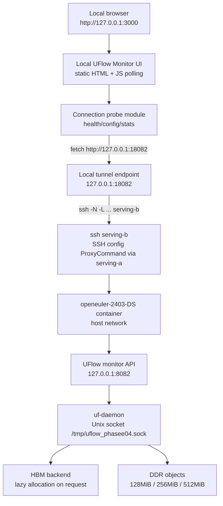

# PhaseE-04: Local Web Monitor over SSH Tunnel

> 开发环境统一口径（2026-08-12）：所有新开发、构建和验证默认使用 `ssh serving-b` → `openeuler-2403-DS` → `/home/sj/git/data-service`；device 必须现场探测并记录。本文中的“1号机/2号机/NPU7”等旧称仅表示历史证据，不再是当前执行指令。详见 [Phase0-development-environment.md](Phase0-development-environment.md)。

Last reviewed: 2026-08-12

Status: Monitor v2 implemented and serving-b functional validation passed; current-session browser screenshot evidence remains pending because loopback navigation was blocked by the Codex in-app browser policy

## 1. 前序文档索引

- `PhaseE-00-independent-data-service-architecture.md`：定义 PhaseE 独立 UFlow 数据服务总架构、DataObject/DataPlacement/TransferPlan/TransferEvent 和 cost-aware Transfer Engine。
- `PhaseE-01-unified-transfer-idl-and-local-exchange.md`：定义统一 transfer IDL，并验证本机 HBM/DDR 交换矩阵。
- `PhaseE-02-service-owned-vmm-transfer-executor.md`：定义 UFlow daemon 自持 service VA，并由 daemon 统一执行 transfer。
- `PhaseE-03-ddr-data-strategy-selection-and-benchmark.md`：确定 DDR object 与 hot transfer pool 的分层策略。
- `PhaseE-05-direction-aware-transfer-channel-manager.md`：规划 H2D/D2H lazy transfer lane、pinned memory budget 和 transfer stats；后续 monitor API/UI 应展示这些指标。
- `Phase0-development-environment.md` 与 `memory/remote_connection.md`：定义当前 abcd 四机连接方式；本任务默认 `ssh serving-b`，进入 `openeuler-2403-DS` 容器和 `/home/sj/git/data-service`。

## 2. 任务定位

PhaseE-04 的目标是做 UFlow 初版 Web Monitor，同时校正 UFlow daemon 的服务形态：

> 本地浏览器打开 UI，数据通过 `ssh serving-b` local forwarding 从 `openeuler-2403-DS` 容器中的 UFlow monitor API 拉取。

首版只验证最小闭环：

1. `serving-b` 的 `openeuler-2403-DS` 容器内启动 UFlow daemon。
2. daemon 常驻暴露 Unix socket 接口，启动时允许对 target device 做小额 HBM probe，但 probe 内存必须立刻释放。
3. client/CLI 请求 HBM 或 DDR object 时，UFlow 才按需调用对应 backend 申请正式资源。
4. 远端启动 monitor API，将 UFlow Unix socket 的 KV 响应转换成 JSON，并提供显式 JSON command bridge。
5. 远端申请少量 DDR object。
6. 本地页面通过已建立的 SSH tunnel 查看 DDR stats、object 状态和链路状态。

文档边界：

- 本文件负责观测面、command bridge、tunnel 和 daemon lifecycle。
- 本文件不负责传输策略实现；PhaseE-03/05 的 transfer stats 后续通过 monitor API 暴露到 UI。

选择这个方案的原因：

- 浏览器不直接处理 SSH，也不保存 SSH 私钥。
- 远端 monitor API 只绑定 `127.0.0.1`，不直接暴露到外网。
- SSH local port forwarding 负责认证和加密；`serving-b` alias 内部的 ProxyCommand 负责经 `serving-a` 接入，UFlow 文档不再维护第二套双跳命令。
- UFlow daemon 应该是按需资源服务，而不是按启动模式拆成 DDR-only / HBM-only 特例。
- 初版不引入 remote agent / WebSocket / 多节点调度，降低实现面。

## 3. 运行模型

PhaseE-04 将远端 UFlow 服务和本地 UI 生命周期解耦：

| 层级 | 组件 | 生命周期 | 说明 |
|---|---|---|---|
| 远端常开层 | `uf-daemon` | long-running | 运行在 `serving-b` 的 `openeuler-2403-DS` 容器内，负责 HBM/DDR/SSD object、lease、transfer 与 stats |
| 远端常开层 | `uflow_monitor_api` | long-running | HTTP API，绑定 `127.0.0.1:8082`，通过 Unix socket 访问 daemon，支持 stats/query 和显式 command |
| 连接层 | SSH tunnel | 常驻监听，可断开、可重连 | 负责把本地 `127.0.0.1:18082` 转发到远端 `127.0.0.1:8082` |
| 本地展示层 | Web UI | 可打开、可关闭 | 只展示监控数据；关闭浏览器不影响远端 UFlow |

关键原则：

- UI 断开、浏览器关闭、tunnel 断开都不停止远端 `uf-daemon`。
- tunnel 可以由运维侧预先建立并保持监听；UI 启动时只检查链路状态，不强依赖自己创建 tunnel。
- 本地 helper 默认只管理本地 UI 和链路探测；是否创建 tunnel 作为可选模块，不绑定业务逻辑。
- 远端 UFlow 的关闭必须通过显式 command 动作触发，不能由 UI close 或 tunnel disconnect 隐式触发。
- tunnel 断开时，UI 应显示 `offline` / `stale`，并保留最后一次成功拉取的时间戳。
- HBM/DDR backend 均按请求 lazy allocation；daemon 启动阶段可以做 1MiB 级别 HBM probe/warmup，但不保留任何启动时 HBM block。

## 4. 总体架构

PhaseE-04 采用方案 A：远端 HTTP monitor API + SSH local port forwarding + 本地前端。



连接路径固定为：

```text
local browser
  -> local UI 127.0.0.1:3000
  -> local tunnel 127.0.0.1:18082
  -> ssh serving-b（SSH config 内部经 serving-a ProxyCommand）
  -> openeuler-2403-DS container
  -> UFlow monitor API 127.0.0.1:8082
  -> uf-daemon Unix socket
```

## 5. 端口与配置

默认端口：

| 组件 | 默认地址 | 说明 |
|---|---|---|
| 本地 UI | `127.0.0.1:3000` | 浏览器打开的页面 |
| 本地 tunnel | `127.0.0.1:18082` | UI 请求的 API base |
| 远端 monitor API | `127.0.0.1:8082` | `serving-b/openeuler-2403-DS` 内 API，默认只经 tunnel 暴露 |
| UFlow daemon socket | `/tmp/uflow_phasee04.sock` | monitor API 到 daemon 的本机 Unix socket |

端口必须可配置：

```text
UF_MONITOR_HOST=127.0.0.1
UF_MONITOR_PORT=8082
UFLOW_API_BASE=http://127.0.0.1:18082
UFLOW_UI_HOST=127.0.0.1
UFLOW_UI_PORT=3000
UF_SOCKET=/tmp/uflow_phasee04.sock
```

页面顶部必须展示当前连接配置，至少包括：

- Local UI URL。
- Local API base。
- Remote monitor API host/port。
- Tunnel path：`local -> ssh serving-b -> openeuler-2403-DS`；ProxyCommand 细节由 SSH config 管理。
- UFlow daemon socket。

## 6. 首版功能范围

首版做 UFlow 服务健康、链路状态、DDR 监控、demo allocation 和显式 command console。HBM 不作为页面重点；daemon 启动可以探测 HBM 路径，但不能长期占用 HBM，也不应因为 HBM probe 失败阻塞 DDR 请求。

必须支持：

- UFlow daemon lazy allocation 启动：启动时不预申请长期 HBM/DDR；可做小额 HBM probe 并立即释放，正式资源按 `CreateDataObject` 请求再申请。
- 申请少量 DDR object：`128MiB / 256MiB / 512MiB`。
- 页面展示：
  - daemon health。
  - link health：local API base、远端 monitor API、daemon socket 的状态。
  - DDR object count。
  - DDR requested bytes。
  - DDR actual bytes。
  - DDR committed bytes。
  - DDR safe allocatable bytes。
  - DDR root。
  - cgroup current / limit。
  - demo object table。
  - JSON command console。
  - 可折叠 command help。
  - 当前 tunnel port 和 remote target。

明确不做：

- HBM/NPU live monitor。
- WebSocket / SSE。
- 强绑定的自动 SSH tunnel 管理。
- 多节点 agent。
- 多 UFlow instance 聚合。
- 生产级鉴权。
- 远端自动部署和自动拉起容器。

## 7. 实施任务

### 7.1 Lazy allocation daemon

重构 `uf-daemon` 启动语义：

```text
daemon start:
  bind Unix socket
  initialize catalog / stats / config
  optionally init target device and run a small HBM probe
  allocate at most 1MiB for probe, then free immediately
  do not keep startup HBM blocks in catalog
  do not create DDR object

CreateDataObject placement=hbm:
  initialize/use HBM backend
  allocate physical HBM only for this request

CreateDataObject placement=ddr:
  create memfd/path DDR object only for this request
```

要求：

- 删除“启动即 HBM prealloc 是服务可用前置条件”的假设。
- daemon 启动允许做 target device init + 小额 HBM 申请/释放 probe，用于预热 ACL/HBM 路径。
- probe 默认大小为 `1MiB`，必须可配置，例如 `UF_HBM_STARTUP_PROBE_BYTES=1048576`。
- probe 成功后必须立即释放 HBM，不进入 `Catalog.blocks`，不出现在 object/lease 统计里。
- probe 失败时记录 `hbm_available=false` 和错误原因，但不得影响 DDR object 创建和 DDR stats。
- `GetStats` 在 HBM backend 不可用时返回 `hbm_available=false`、HBM bytes 为 `0` 或 `unknown`，不能导致整个 stats 失败。
- 后续 CLI 预申请可以走普通 client API 创建 HBM/DDR object，不需要特殊 daemon mode。
- PhaseE-04 不新增 `--disable-hbm`，避免把 UFlow 做成按启动模式分裂的服务。

### 7.2 Monitor API sidecar and command bridge

新增 monitor API sidecar。默认路径仍以观测为主；显式 `POST /v1/command` 用于把 UI/CLI 的 JSON command 转换成 daemon 当前 Unix socket KV 协议。

建议实现方式：

- Python stdlib HTTP server。
- 不引入 FastAPI/Flask 等依赖。
- 通过现有 UFlow Unix socket 协议访问 daemon。
- 默认绑定 `127.0.0.1:8082`。

首版 API：

```text
GET /healthz
GET /v1/config
GET /v1/stats
GET /v1/observability
GET /v1/objects?model_id=phasee04-monitor
GET /v1/trace/status
GET /v1/trace/artifact?run_id=<run_id>&file=trace_events.json
POST /v1/command
POST /v1/trace/start
POST /v1/trace/stop
POST /v1/trace/flush
```

返回 JSON。CORS 只允许 `localhost` / `127.0.0.1`。

JSON 语义：

- `/healthz`：只描述 monitor API 自身、daemon socket 可达性和最近一次 daemon ping。
- `/v1/config`：返回 local/remote/tunnel/daemon socket 配置，不包含 SSH 私钥。
- `/v1/stats`：返回 daemon `GetStats` 的 JSON 化结果，保留数字字段为 number。
- `/v1/observability`：聚合 health、stats、trace status，是 PhaseE-06 之后的统一观测入口。
- `/v1/objects`：返回 `GetModelObjects` 的 JSON array，不把 daemon KV 字符串透传给 UI。
- `/v1/trace/status`：返回 daemon `GetTraceStatus` 的 JSON 化结果。
- `/v1/trace/start|stop|flush`：通过 HTTP 控制 daemon-native trace；trace 默认关闭，只有显式 start 后才记录细粒度事件。
- `/v1/trace/artifact`：读取 `trace_events.json`、`trace_summary.json`、`trace_summary.csv`、`summary.md`。首版只允许读取 `UF_TRACE_OUTPUT_DIR/<run_id>/` 下的固定文件名。
- `/v1/command`：接收 JSON command，例如 `CreateDataObject`、`ReleaseDataObject`、`GetStats`、`GetModelObjects`、`ShutdownDaemon`；monitor API 做 JSON 到 KV 的协议桥接。

`/v1/command` 约束：

- command body 必须是 JSON object。
- 字段值只允许 string / number / boolean。
- 值不能包含 `;` 或 `=`，以兼容当前 KV line 协议。
- `CreateDataObject` / `CreateBuffer` 未携带 `client_id` 时，monitor API 自动注册一个 `monitor-ui` client 并补入 `client_id`。
- `GetTraceStatus`、`StartTrace`、`StopTrace`、`FlushTrace`、`ClearTrace`、`ExportTrace` 已加入 command allowlist；UI/CLI 可以走 `/v1/command`，也可以走 `/v1/trace/*` 便捷接口。
- `ShutdownDaemon` 必须由用户显式点击 send command 触发；模板按钮只填入 JSON，不直接执行。

### 7.3 DDR seed tool

新增 demo DDR object 创建工具。

行为：

- 注册或使用固定 `model_id=phasee04-monitor`。
- 创建一个 DDR object。
- 默认大小 `256MiB`。
- 支持 `--bytes` 配置为 `128MiB / 256MiB / 512MiB` 等。
- 支持 `--hold`，保持 lease 存活，便于 UI 展示。
- Ctrl-C 后释放 object，并让 UI 下一轮刷新看到 stats 回落。

### 7.4 Local UI

新增本地 Web UI。

建议目录：

```text
data-service/ui/uflow-monitor
```

建议技术栈：

- 首版使用静态 HTML + CSS + JavaScript，减少 npm/Vite 依赖。
- 通过 `fetch` 轮询 JSON API，不做 WebSocket / SSE。
- 后续再升级为 Vite / React / TypeScript 和更复杂 dashboard。

首版页面：

- Overview。
- DDR stats。
- Demo objects。
- Connection / tunnel info。
- Command console。
- Command Help：列出可发送的 JSON command 示例。
- Error banner：API 不可达、JSON parse 失败、healthz 失败。

轮询间隔首版使用 2 秒。

实时反馈要求：

- 每 2 秒刷新 `/healthz`、`/v1/stats` 和 `/v1/objects?model_id=phasee04-monitor`。
- 页面显示最后成功刷新时间、连续失败次数、当前状态 `online/offline/stale`。
- API 失败时保留上一次成功数据，并显示 stale 标记。
- `Send Command` 成功后立即刷新 stats/object table。
- `ShutdownDaemon` 成功后页面下一轮 health 应显示 daemon offline，而 monitor API 自身仍存活。

### 7.5 Link check module and local helper script

PhaseE-04 将链路检查模块化，后续可替换不同机器、key、跳板方式。

建议新增链路配置：

```text
data-service/tools/phasee04/uflow_monitor_link.env
```

字段：

```text
UFLOW_API_BASE=http://127.0.0.1:18082
UFLOW_UI_HOST=127.0.0.1
UFLOW_UI_PORT=3000
UFLOW_TUNNEL_PATH=local->ssh-serving-b->openeuler-2403-DS
UFLOW_REMOTE_MONITOR=http://127.0.0.1:8082
UF_SOCKET=/tmp/uflow_phasee04.sock
```

新增本地 helper 脚本设计：

```text
data-service/tools/phasee04/uflow_monitor_local.sh
```

首版职责采用 `LinkCheck+UI`，tunnel 创建是可选能力：

- 检查本地 API base 是否可达。
- 检查远端 monitor API 经 tunnel 暴露的 `/healthz`。
- 启动或复用轻量本地 UI server。
- 打开 `http://127.0.0.1:3000`。
- 在终端输出 current config 和链路状态。
- 可选：当配置允许时，建立或重建 `local -> ssh serving-b -> openeuler-2403-DS` tunnel。

首版不负责默认拉起远端 daemon/API；远端服务和 tunnel 可按常开模式单独管理。

脚本命令：

| 命令 | 行为 |
|---|---|
| `start` | 检查端口和 API base，启动 UI，打开浏览器，输出 current config |
| `status` | 调用 `/healthz`、`/v1/config`、`/v1/stats`，报告 UI/API/tunnel/daemon 链路状态 |
| `reconnect` | 可选命令：停止本地旧 tunnel 并重建，不影响远端 daemon/API |
| `stop-local` | 只停止本地 UI；如果 helper 创建过本地 tunnel，则只停止本地 tunnel |
| `stop-remote` | 当前只作为后续显式命令语义保留，PhaseE-04 不默认实现 |

helper 需要记录：

```text
/tmp/uflow_phasee04_monitor/
  tunnel.pid
  ui.pid
  tunnel.log
  ui.log
  config.env
  status.json
```

端口或链路异常时必须 fail fast 或在 UI 顶部报告：

- local UI port occupied。
- local API base unreachable。
- remote monitor API `/healthz` failed。
- daemon socket unreachable。
- JSON parse failed。

### 7.6 Optional tunnel management

`serving-b` tunnel 可以由运维侧预先建立并保持监听。PhaseE-04 UI 启动时只依赖本地 `UFLOW_API_BASE` 是否可达。

如果 helper 管理 tunnel，SSH 选项必须包含：

```text
-o ExitOnForwardFailure=yes
-o ServerAliveInterval=20
-o ServerAliveCountMax=3
```

建议把机器连接方式配置化，而不是写死在 UI 逻辑中：

```text
UFLOW_REMOTE_SSH=serving-b
UFLOW_REMOTE_CONTAINER=openeuler-2403-DS
UFLOW_REMOTE_WORKDIR=/home/sj/git/data-service
UFLOW_LOCAL_API_PORT=18082
UFLOW_REMOTE_API_PORT=8082
```

不再使用 `next`、`UFLOW_HOST1_*`、`UFLOW_HOST2_*` 或手写 ProxyCommand；连接细节以本机 SSH config 中的 `serving-b` 为准。

### 7.7 Remote long-running service runbook

默认目标为 `serving-b`。SSH alias 已封装经 `serving-a` 的连接方式；远端 `uf-daemon`、monitor API 和可选 tunnel 按常开服务处理。

远端日志和 PID 目录：

```text
/tmp/proj_output/phasee04_monitor_<run_id>/
  daemon.pid
  daemon.log
  monitor_api.pid
  monitor_api.log
  env.log
```

在 `serving-b` 的 `openeuler-2403-DS` 容器内启动 daemon；进入容器后先用 `npu-smi info` 选择实际 device：

```bash
cd /home/sj/git/data-service
cmake -S . -B build
cmake --build build --target uf_acl_shim -j
cargo build -p uf-daemon

export UF_SOCKET=/tmp/uflow_phasee04.sock
export UF_DDR_ROOT=/tmp/uflow_phasee04_ddr
export LD_LIBRARY_PATH=/home/sj/git/data-service/build/lib:${LD_LIBRARY_PATH:-}
: "${DS_TARGET_DEVICE:?set DS_TARGET_DEVICE after npu-smi preflight}"
./target/debug/uf-daemon \
  --device "${DS_TARGET_DEVICE}" \
  --socket "$UF_SOCKET" \
  --startup-probe-bytes "${UF_HBM_STARTUP_PROBE_BYTES:-1048576}" \
  > /tmp/proj_output/phasee04_monitor_<run_id>/daemon.log 2>&1 &
echo $! > /tmp/proj_output/phasee04_monitor_<run_id>/daemon.pid
```

在同一 `serving-b/openeuler-2403-DS` 容器内启动 monitor API：

```bash
cd /home/sj/git/data-service
export UF_SOCKET=/tmp/uflow_phasee04.sock
export UF_MONITOR_HOST=127.0.0.1
export UF_MONITOR_PORT=8082
python tools/uflow_monitor_api.py \
  > /tmp/proj_output/phasee04_monitor_<run_id>/monitor_api.log 2>&1 &
echo $! > /tmp/proj_output/phasee04_monitor_<run_id>/monitor_api.pid
```

在同一容器内创建 DDR demo object：

```bash
cd /home/sj/git/data-service
export UF_SOCKET=/tmp/uflow_phasee04.sock
python examples/phasee04/uflow_monitor_seed_ddr.py \
  --model-id phasee04-monitor \
  --name demo.ddr.256m \
  --bytes 268435456 \
  --hold
```

远端 health check：

```bash
curl http://127.0.0.1:8082/healthz
UF_SOCKET=/tmp/uflow_phasee04.sock python - <<'PY'
from pathlib import Path
import os, socket
sock = socket.socket(socket.AF_UNIX, socket.SOCK_STREAM)
sock.connect(os.environ["UF_SOCKET"])
sock.sendall(b"op=GetStats\n")
print(sock.recv(65536).decode())
PY
```

首版可以用 `nohup` 或 `tmux` 保持远端常开。后续再讨论 supervisor / systemd 化。

### 7.8 SSH tunnel runbook

人工调试只需要一条本地转发命令：

```bash
ssh \
  -o ExitOnForwardFailure=yes \
  -o ServerAliveInterval=20 \
  -o ServerAliveCountMax=3 \
  -N -L 18082:127.0.0.1:8082 \
  serving-b
```

本地启动 UI：

```bash
cd data-service/ui/uflow-monitor
UFLOW_API_BASE=http://127.0.0.1:18082 \
python3 -m http.server 3000 --bind 127.0.0.1
```

浏览器打开：

```text
http://127.0.0.1:3000
```

### 7.9 Remote shutdown policy

远端关闭策略采用显式 command。

原则：

- UI 关闭不停止远端 daemon/API。
- `stop-local` 只停止本地 UI；如果 tunnel 是 helper 创建的，才停止本地 tunnel。
- tunnel 断开不停止远端 daemon/API。
- 远端 daemon 关闭必须由显式 `ShutdownDaemon` command 触发，例如：

```json
{ "op": "ShutdownDaemon" }
```

PhaseE-04 已实现 daemon 内部 `ShutdownDaemon`：daemon 响应 command 后设置 shutdown flag，主循环退出并执行 cleanup。

未来显式关闭动作需要区分：

| 动作 | 语义 |
|---|---|
| stop monitor API | 只关闭 HTTP monitor，不影响 `uf-daemon` |
| stop daemon | 发送 `ShutdownDaemon`，关闭 UFlow daemon，释放由 daemon owning 的资源 |
| cleanup demo objects | 释放 PhaseE-04 seed tool 创建的 demo DDR object |

## 8. 验收标准

文档验收：

- 文件存在：`data-service/plan/PhaseE-04-local-web-monitor-over-ssh-tunnel.md`。
- 文档包含默认端口 `8082 / 18082 / 3000`。
- 文档包含 `ssh serving-b` 单 alias 与 SSH config ProxyCommand 说明。
- 文档包含 lazy allocation daemon 语义和小额 HBM startup probe 语义。
- 文档包含方案 C 后续演进说明。
- 文档包含 SSH 断线风险说明。
- 文档包含 local helper script 设计。
- 文档包含链路检查模块化设计。
- 文档明确 UI/tunnel 与远端 UFlow 生命周期解耦。
- 文档明确远端关闭必须显式 CLI 触发。

功能验收：

1. `serving-b/openeuler-2403-DS` 内能启动 lazy allocation `uf-daemon`；实际 device 已由 preflight 选择并记录；启动时可完成 1MiB HBM probe 并立即释放，不留下长期 HBM block。
2. `curl http://127.0.0.1:8082/healthz` 通过。
3. 创建 `256MiB` DDR demo object 后，`GetStats` 中 DDR object 数量和 committed bytes 增加。
4. 本地浏览器打开 `http://127.0.0.1:3000`，页面能通过 `http://127.0.0.1:18082` 展示远端 stats。
5. 停止 seed tool 后，页面刷新能看到 DDR object 或 committed bytes 回落。
6. 断开本地 tunnel 后，远端 daemon/API 仍存活。
7. 重新执行 helper `reconnect` 后，UI 恢复显示 stats。
8. `stop-local` 不影响远端 daemon/API 和 DDR object。
9. 只有显式 remote stop 才关闭远端 daemon/API。
10. 测试结束后清理：
   - `/tmp/uflow_phasee04.sock`
   - `/tmp/uflow_phasee04_ddr`
   - `uf-daemon`
   - monitor API 进程
   - seed tool 进程

## 9. 风险与约束

| 风险 | 处理 |
|---|---|
| `serving-b` NPU 被占用 | 先用 `npu-smi info` 选择并记录其它健康空闲 device；只做 DDR 请求时不触发 HBM 申请 |
| 8080 端口冲突 | 默认远端端口使用 `8082`，本地 tunnel 使用 `18082` |
| SSH tunnel 断开 | tunnel 可常驻；helper 使用 keepalive 和 `ExitOnForwardFailure`；断线后 UI 显示 offline/stale |
| SSH alias/ProxyCommand 配置错误 | 开工先执行 `ssh serving-b` preflight；helper 输出实际 hostname/container/repo，禁止回退到旧 `next` 链路 |
| 误关远端 UFlow | UI 和 `stop-local` 不关闭远端；远端 stop 必须显式 CLI + confirm |
| 容器网络差异 | 当前按 host 网络映射处理；monitor API 仍只绑定 `127.0.0.1` |
| DDR 空间不足 | seed 默认 256MiB，可降到 128MiB；创建前看 `ddr_safe_allocatable_bytes` |
| API 暴露风险 | API 绑定 localhost，通过 SSH tunnel 访问；写操作集中在显式 `/v1/command` |
| 浏览器跨域 | 首版 CORS 只允许 localhost / 127.0.0.1 |
| daemon cleanup 不完整 | 验收必须检查 socket、DDR root 和进程残留 |

## 10. 后续演进

PhaseE-04 是初版本地 monitor。后续可演进为方案 C：

- remote monitor agent。
- modular UI backend。
- 多机器、多容器、多 UFlow instance。
- WebSocket / SSE live transfer timeline。
- PhaseE transfer stats 统一接入。
- HBM/NPU live monitor。
- Topology / UB / SSU / DFS 视图。
- 多环境 connector：不同跳板、key、容器入口、云环境 tunnel 策略。
- 远端 supervisor / systemd / agent 管理。
- 用户可配置 dashboard layout。

长期目标：

> UFlow UI 不只展示当前 DDR/HBM 使用量，而是成为统一数据服务的观测面：对象在哪里、谁在使用、数据如何流动、每条路径成本是多少、哪条路径正在成为瓶颈。

## 11. 2026-06-15 历史实施记录（旧 1/2 号机环境）

本轮已完成 PhaseE-04 的首版实现和旧 2 号机验证；该结果是历史证据，不代表当前 `serving-b` 已复验。

### 11.1 代码落地

新增或更新：

- `crates/uf-daemon/src/main.rs`：daemon 启动从长期 HBM prealloc 改为 lazy allocation + 小额 HBM startup probe。
- `crates/uf-daemon/src/catalog.rs`：新增 `HbmRuntimeStatus`，记录 probe 和 HBM runtime 可用性。
- `crates/uf-daemon/src/protocol.rs`：`GetStats` 显式返回 `hbm_available`、probe 信息、HBM 错误信息；动态 HBM 分配成功/失败会更新状态；新增 `ShutdownDaemon`。
- `tools/uflow_monitor_api.py`：monitor API，将 daemon Unix socket KV 协议转换为 JSON，并提供 `POST /v1/command`。
- `examples/phasee04/uflow_monitor_seed_ddr.py`：创建并可选持有 demo DDR object，Ctrl-C/SIGTERM 后释放 object。
- `ui/uflow-monitor/`：静态 HTML/CSS/JS UFlow Monitor 页面，每 2 秒轮询 health/stats/objects；新增 command console 和可折叠 command help。
- `tools/phasee04/uflow_monitor_local.sh`：本地 UI + link check helper；tunnel 创建为可选模块。

### 11.2 远端验证环境

```text
machine: 2号机
container: openeuler-2403-DS
workdir: /home/sj/git/data-service
run_id: phasee04_20260615_170414
run_dir: /tmp/proj_output/phasee04_20260615_170414
target_device: 7
daemon_socket: /tmp/uflow_phasee04.sock
remote_monitor_api: 127.0.0.1:8082
local_tunnel_api: 127.0.0.1:18082
```

验证期间常开进程：

```text
uf-daemon pid: 265197
monitor API pid: 265254
1号机 -> 2号机 tunnel pid: 2886932
```

当前清理状态：验证结束后，本地 UI server、本地 -> 1号机 tunnel、1号机 -> 2号机 tunnel、2号机容器内 `uf-daemon`、monitor API 和 seed 进程均已停止；`/tmp/uflow_phasee04.sock` 和 `/tmp/uflow_phasee04_ddr` 已清理。

### 11.3 验证结果

构建：

```text
cmake -S . -B build: pass
cmake --build build --target uf_acl_shim -j: pass
cargo check -p uf-daemon: pass
cargo build -p uf-daemon: pass
python py_compile monitor API / seed tool: pass
bash -n local helper: pass
node --check UI app.js: pass
```

HBM startup probe：

```text
device_id: 7
requested_bytes: 1048576
granularity: 2097152
actual_bytes: 2097152
result: allocated then released
catalog block_count after startup: 0
hbm_available: true
```

Monitor API：

```text
GET /healthz: pass
GET /v1/stats: pass
GET /v1/objects?model_id=phasee04-monitor: pass
POST /v1/command GetStats: pass
POST /v1/command CreateDataObject: pass
POST /v1/command ReleaseDataObject: pass
POST /v1/command ShutdownDaemon: pass
```

PhaseE-06 trace / observability API 追加验证：

```text
GET /v1/observability: pass
GET /v1/trace/status: pass
POST /v1/trace/start: pass
POST /v1/trace/flush: pass
POST /v1/trace/stop: pass
GET /v1/trace/artifact?run_id=smoke_hot&file=trace_events.json: pass
GET /v1/trace/artifact?run_id=smoke_hot&file=trace_summary.json: pass
Run dir: /tmp/proj_output/phasee06_trace_smoke_20260622_145322
```

DDR seed：

```text
created object: demo.ddr.256m
requested_bytes: 268435456
placement: ddr
target: host:0
ddr_path: /tmp/uflow_phasee04_ddr/uflow_ddr_object_100
stats while held: ddr_objects=1, ddr_committed_bytes=268435456
SIGTERM cleanup: lease_closed + object_released
stats after cleanup: ddr_objects=0, ddr_committed_bytes=0
```

Tunnel/UI：

```text
2号机宿主 -> monitor API 127.0.0.1:8082: pass
1号机 -> 2号机 tunnel 127.0.0.1:18082 -> 127.0.0.1:8082: pass
本地 -> 1号机 tunnel 127.0.0.1:18082 -> 127.0.0.1:18082: pass
本地 curl http://127.0.0.1:18082/healthz: pass
本地静态 UI HTML/API check: pass
Browser 插件 DOM check: pass
```

Browser 插件读到的页面关键信号：

```text
title: UFlow Monitor
status: online
daemon: online
hbm: available
ddr_objects: 0
hbm_free: 3.2 GiB
architecture diagram: 816 x 360
healthDetailHasOk: true
```

### 11.4 Command console 增量验证

本轮在 PhaseE-04 UI 上新增 command console，可从浏览器发送 JSON command。

增量验证环境：

```text
run_id: phasee04_ui_command_20260615_181034
target_device: 7
uf-daemon pid after restart: 267837 -> shutdown -> restarted
monitor API pid: 267847
```

验证结果：

```text
POST /v1/command {"op":"GetStats"}: pass
POST /v1/command CreateDataObject 1MiB DDR object: pass
  auto_client_id: 1
  object_id: 100
  ddr_path: /tmp/uflow_phasee04_ddr/uflow_ddr_object_100
POST /v1/command ReleaseDataObject object_id=100: pass
POST /v1/command ShutdownDaemon: pass
  command response: shutdown_requested
  daemon log: daemon_shutdown_begin + daemon_shutdown_complete
  health after shutdown: HTTP 503 from /healthz
daemon restart after shutdown test: pass
```

最终清理确认：

```text
local 127.0.0.1:3000: no listener
local 127.0.0.1:18082: no listener
1号机 18082 tunnel: stopped
2号机容器 uf-daemon: stopped
2号机容器 monitor API: stopped
2号机容器 temp socket / DDR root: removed
```

### 11.5 发现与修正

- `cargo check` 不会链接 `libuf_acl_shim.so`，但 `cargo build` 需要先通过 CMake 构建 C++ shim。
- Rust daemon 运行时需要 `LD_LIBRARY_PATH=/home/sj/git/data-service/build/lib:${LD_LIBRARY_PATH:-}`。
- `GetModelObjects` 返回字段中 `target=host:0` / `npu:7` 含冒号，monitor API 不能简单按固定冒号位置解析；已改为先解析稳定字段，再解析 address tail。
- Codex 本地 `exec_command` 后台进程可能随命令结束被清理；实际本地验证可用前台会话或用户 shell 运行 helper。

## 12. 本地一键拉起 serving-b Monitor 链路

旧 wrapper `tools/phasee04/uflow_monitor_machine2_local_setup.sh` 仍编码了 `HOST1/HOST2` 两段链路，只能解释历史验证，**不得继续作为当前默认入口**。E04-M0 负责新增：

```text
data-service/tools/phasee04/uflow_monitor_serving_b_local_setup.sh
```

在新 wrapper 合入前，使用 7.7 的远端服务步骤和 7.8 的单条 `ssh serving-b` tunnel 命令手工启动。

新 wrapper 的使用前提：

- 本地 `~/.ssh/config` 已配置 `serving-b`，且 `ssh serving-b` 可达。
- `serving-b` 上存在 `openeuler-2403-DS` 容器和 `/home/sj/git/data-service`。
- 容器内 `uf-daemon` 由用户单独启动并监听 `UF_SOCKET`，默认 `/tmp/uflow_phasee04.sock`。

目标命令合同：

```bash
cd ${MEMORY_SERVICE_ROOT}/data-service

UFLOW_REMOTE_SSH=serving-b \
UFLOW_REMOTE_CONTAINER=openeuler-2403-DS \
UFLOW_REMOTE_WORKDIR=/home/sj/git/data-service \
UF_SOCKET=/tmp/uflow_phasee04.sock \
UFLOW_LOCAL_API_PORT=18082 \
UFLOW_UI_PORT=3000 \
tools/phasee04/uflow_monitor_serving_b_local_setup.sh start
```

新脚本必须自动完成：

1. 用 `ssh serving-b` 检查 hostname、容器、remote repo、daemon socket；不符合时 fail fast 并打印实际目标。
2. 检查容器内 monitor API `127.0.0.1:8082`；已存在则复用，不存在则从 `/home/sj/git/data-service` 拉起。
3. 检查本地 `http://127.0.0.1:18082/healthz`；未连通时建立：

```text
local:18082 -> ssh serving-b -> 127.0.0.1:8082
```

4. 检查本地 UI `127.0.0.1:3000`；已存在则复用，不存在则启动 `ui/uflow-monitor` 静态页面。
5. 输出实际 `ssh_alias/hostname/container/repo/commit/API/UI` 和最终访问地址：

```text
http://127.0.0.1:3000/?api=http://127.0.0.1:18082
```

目标命令：

```bash
tools/phasee04/uflow_monitor_serving_b_local_setup.sh status
tools/phasee04/uflow_monitor_serving_b_local_setup.sh reconnect
tools/phasee04/uflow_monitor_serving_b_local_setup.sh stop-local
```

`stop-local` 只停止本轮本地 UI/tunnel，不停止远端 API/daemon。脚本只能清理自己 PID 文件中且命令行匹配的进程。

默认配置：

| 变量 | 默认值 | 含义 |
|---|---|---|
| `UFLOW_REMOTE_SSH` | `serving-b` | 当前默认 SSH alias |
| `UFLOW_REMOTE_CONTAINER` | `openeuler-2403-DS` | 当前默认容器 |
| `UFLOW_REMOTE_WORKDIR` | `/home/sj/git/data-service` | 容器内 UFlow 目录 |
| `UF_SOCKET` | `/tmp/uflow_phasee04.sock` | daemon Unix socket |
| `UF_MONITOR_PORT` | `8082` | 远端 monitor API 端口 |
| `UFLOW_LOCAL_API_PORT` | `18082` | 本地 API tunnel 端口 |
| `UFLOW_UI_PORT` | `3000` | 本地 UI 端口 |

`UFLOW_HOST1_*`、`UFLOW_HOST2_*` 和 `UFLOW_HOST1_FORWARD_PORT` 已废弃，不得出现在新 wrapper 的主路径。

## 13. Monitor v2：适配当前 HBM↔DDR 与 HBM↔SSD 传输（2026-08-12）

### 13.1 当前审计结论

E04 v1 的 daemon lifecycle、SSH tunnel、基础 HTTP API 和静态 UI 已经成立，但它仍是 DDR-first 的监控页面，尚不能完整解释当前 Transfer Engine 的多介质行为。

| 能力 | daemon 当前已有数据 | Monitor v1 现状 | 判断 |
|---|---|---|---|
| HBM/DDR/SSD 容量与对象计数 | `GetStats` 已返回三类介质的对象数/字节数，SSD 还包含 filesystem、读写字节/次数和 IO mode | 页面只突出 DDR 与 HBM free | 未适配完整 |
| HBM↔DDR direct / pinned fallback | event 已有 planned/actual path、engine、lane、queue/worker、ACL 和 fallback 字段 | 页面没有最近传输、实际路径或 fallback 视图 | 未适配 |
| SSD↔DDR | event 已有 SSD IO latency/bytes/bandwidth/read/write 字段 | 页面没有 SSD IO 指标和传输记录 | 未适配 |
| SSD↔HBM relay | event 已有 relay stage count、SSD↔DDR 与 DDR↔HBM 分段时间 | 页面无法显示两段耗时 | 未适配 |
| SSD↔HBM logical direct | event 已有 candidate/kind/setup/register/ACL/total 等字段 | 页面无法区分 logical direct、relay 和 runtime fallback | 未适配，且存在误报为 physical direct 的风险 |
| SSD object backing path | daemon 已返回 SSD backing path | API/UI 仍使用 `ddr_path` 命名 | 语义错误，必须修复 |
| trace 状态与产物 | HTTP API 已有 trace control/status/artifact | 页面只有基础状态，没有产物下载与 transfer-level 联动 | 部分适配 |

因此，E04 v1 保持“已完成”；本节定义的 Monitor v2 是新的必做工作，不得用 v1 的历史验收结果标记完成。

### 13.2 目标、边界与不变量

Monitor v2 的目标是让使用者在一个页面回答以下问题：

1. HBM、DDR、SSD 当前各用了多少、还剩多少；
2. 最近一次或最近一批传输实际走了哪条 path、哪个 engine；
3. HBM↔DDR 是 direct 还是 pinned fallback，排队、worker、lane 和 ACL 分别耗时多少；
4. SSD↔DDR 的 IO 耗时/吞吐是多少；
5. SSD↔HBM 是 relay、logical direct，还是 direct 失败后 runtime fallback；
6. 当前 trace 是否开启，最近一次产物是否可下载。

必须保持以下不变量：

- Monitor 是只读观测面；除既有显式 command/trace control 外，不新增自动调度、自动迁移或自动重试行为。
- `planned_path` 与 `actual_path`、`planned_engine` 与 `actual_engine` 必须分列显示，不能用计划值冒充执行结果。
- `direct_kind=logical` 必须完整展示为 **logical direct**；在没有硬件证据前禁止显示为 NVMe/SSU physical direct。
- fallback 必须同时显示 `fallback_used` 和 `fallback_reason`；planner 直接选择 relay 不得伪装成 runtime fallback。
- UI/API 请求必须有界；默认最近 50 条、单次硬上限 200 条，禁止把整个 event catalog 无界返回给浏览器。
- polling 失败时保留最后成功时间并显示 `offline/stale`，禁止继续显示为实时健康。
- 不在本任务内引入 WebSocket/SSE、内嵌 Perfetto、跨 daemon 聚合、鉴权系统或持久化 event catalog。

### 13.3 统一读模型与接口合同

#### 13.3.1 daemon 只读查询

新增 solid read op `ListTransferEvents`，只负责枚举有界 event id：

```text
request:
  op=ListTransferEvents
  limit=50                    # 默认 50，最大 200
  before_event_id=<optional>  # 向后翻页
  status=<optional>
  client_id=<optional>

response:
  event_ids=<newest-first ids>
  returned=<n>
  has_more=<true|false>
  next_before_event_id=<optional>
```

要求：

- event id 排序必须稳定；已删除/不可见 event 不导致整次请求失败。
- `GetCapabilities` 必须宣告该 op。
- `TransferPlanRecord` 必须持久化规范化后的 `requested_mode`（空请求按现有规则记为 `auto`）；`PollEvent` 在保持旧字段兼容的前提下补齐监控所需上下文：
  `src_object_id/dst_object_id/src_medium/dst_medium/operation/requested_mode/nbytes/planned_path/planned_engine`。
- `PollEvent` 现有实际执行字段继续作为唯一真值源：
  `actual_path/actual_engine/status/actual_latency_us/actual_bandwidth_gib_s/fallback_*`，以及 channel、SSD IO、relay、direct candidate 各分段字段。
- object JSON 统一输出 `backing_path`；为兼容旧消费者可暂时保留 `ddr_path` alias，但 SSD object 不得再被标注成 DDR path。
- 不改变 event 生命周期、资源回收或 transfer 选路；本任务只增加只读索引和兼容字段。

#### 13.3.2 HTTP API

新增两个只读端点：

```text
GET /v1/transfers
  ?limit=50
  &before_event_id=<optional>
  &status=<optional>
  &path=<optional actual_path>
  &engine=<optional actual_engine>
  &client_id=<optional>

GET /v1/transfers/summary
  ?limit=200
```

`/v1/transfers` 每条记录至少返回：

```text
event_id, plan_id, status
src_object_id, dst_object_id, src_medium, dst_medium, direction
operation, requested_mode, nbytes
planned_path, planned_engine, actual_path, actual_engine
actual_latency_us, actual_bandwidth_gib_s
fallback_used, fallback_reason, error
channel/lane/queue/worker fields
ssd_io_* fields
relay_* fields
direct_candidate/direct_kind/direct_* fields
```

`/v1/transfers/summary` 基于同一批有界 event 计算，至少包含：

- 按 `actual_path + actual_engine + direction + status` 分组的 count、bytes、p50/p95 latency、p50/p95 bandwidth；
- fallback count 与 fallback rate；
- SSD read/write bytes、ops 和 IO time；
- `sample_size`、`window_limit` 和生成时间，明确它不是全生命周期累计值。

非法 filter、负数 limit 或 `limit > 200` 返回 HTTP 400；daemon 不在线返回 503；单条 event 在并发回收中消失时跳过并在响应中返回 `skipped_event_ids`，不能把完整请求误报为 500。

`/v1/observability` 可以加入上述 summary 的轻量摘要，但不得嵌入完整 transfer 列表。现有端点及 JSON 字段保持向后兼容。

### 13.4 实施任务与文件归属

执行 agent 按下列 ID 回填进展；每项完成时必须给出 commit、命令、机器/device 和结果目录。

| ID | 工作 | 主要文件 | 完成证据 |
|---|---|---|---|
| E04-M0 | 先按 Phase0 环境门禁无损处理 remote `e854fa0` dirty worktree 与 local `6179941` 差异；再将运行入口迁移到 `serving-b` 单 alias，新增 `uflow_monitor_serving_b_local_setup.sh`，保留旧 machine2 wrapper 仅作带警告兼容入口 | `tools/phasee04/`、本文件、必要时 `README.md` | 远端改动未丢失且执行基线明确；preflight、start/status/reconnect/stop-local 在 `serving-b` 通过；实际 hostname/container/repo/commit 被记录；旧变量不进入默认路径 |
| E04-M1 | 持久化 `requested_mode`，增加 `ListTransferEvents`、稳定分页、capability 宣告，并兼容性扩展 `PollEvent` 上下文字段 | `crates/uf-daemon/src/router.rs`、`crates/uf-daemon/src/common.rs`、`crates/uf-daemon/src/transfer_planner.rs`、必要时 `catalog.rs` | Rust 单测/静态检查；默认/显式 mode、空列表、分页、过滤、并发消失 event 用例通过 |
| E04-M2 | 修正 object backing path 语义，实现 `/v1/transfers` 与 `/v1/transfers/summary`，补参数校验、503 与 partial-result 行为 | `tools/uflow_monitor_api.py` | Python 单测覆盖成功、非法参数、daemon offline、partial result、SSD object path |
| E04-M3 | 重做 Overview：HBM/DDR/SSD 容量卡、SSD filesystem/IO、executor queue/worker、H2D/D2H lane 指标 | `ui/uflow-monitor/index.html`、`app.js`、`styles.css` | 三介质数据可见；缺字段时显示 `N/A` 而非伪造 0 |
| E04-M4 | 增加 Recent Transfers 表、filter、分页/刷新和详情区，展示 planned→actual、stage metrics、error/fallback | 同上 | HBM↔DDR、SSD↔DDR、SSD↔HBM 三类记录均可辨认；logical direct 标签正确 |
| E04-M5 | 补 trace 状态、最后 flush 产物和下载入口；只消费 E06 合同，不在本任务重写 trace writer | `ui/uflow-monitor/*`、必要时 `tools/uflow_monitor_api.py` | trace disabled/enabled/flushed 三种状态正确；产物不存在时给出明确提示 |
| E04-M6 | 增加自动化回归与 `serving-b/openeuler-2403-DS` 端到端验收脚本，更新本文件实施记录 | `tools/tests/`、`tools/phasee04/`、本文件 | 13.6 全矩阵通过，保存环境快照、实际 device、JSON、页面截图和 run dir |

代码所有权约束：

- E04 agent 负责 monitor API/UI 与 daemon 只读 event 索引；不得顺手改变 transfer path、cost、fallback 或 trace span 语义。
- E06 agent 负责 trace schema/writer/instrumentation。若两项由不同 agent 执行，推荐 **E06 先完成 trace v2，E04 再基于最终字段合同接入**；不得并行修改同一 daemon 文件后互相覆盖。
- 仓库中可能存在其他人的修改。agent 只能改本表列出的相关文件，不得回滚、清理或格式化无关改动。

### 13.5 UI 最小信息架构

```text
Connection / last successful refresh / daemon baseline
  ├─ Capacity: HBM | DDR | SSD
  ├─ Executor: queue | workers | completed | wait/execute
  ├─ Lanes: H2D | D2H | busy | acquire wait | stream/event reuse
  ├─ Transfer summary: path/engine/direction/status/fallback
  ├─ Recent transfers
  │    └─ detail: SSD IO | relay stages | direct setup/ACL | error
  └─ Trace: status | buffered/dropped | last artifact | download
```

Recent Transfers 默认按 `event_id` 倒序，至少提供 status、actual path、actual engine 和 direction 过滤。行级视觉规则：

- success：正常；failed/cancelled：错误色；runtime fallback：警告色；
- planned 与 actual 不同但 `fallback_used=false` 时显示“planner/metadata mismatch”，不能静默吞掉；
- `ssd_hbm_*_direct` 且 `direct_kind=logical` 时显示 `SSD↔HBM logical direct`；
- relay 展开后显示 SSD IO 与 DDR↔HBM 两段；direct 展开后显示 candidate setup/register/pre-touch/ACL/total；
- bytes、latency 和 bandwidth 必须带单位并保留原始数值供复制，空值显示 `N/A`。

### 13.6 验收矩阵

| Gate | 场景 | 必须检查 | 产物 |
|---|---|---|---|
| G0 静态/单测 | 无 NPU 的 API parser、分页、filter、summary、对象路径 | Python tests；JS syntax；Rust format/check/test（可在远端） | test log |
| G1 兼容 | v1 daemon 响应缺少 v2 可选字段 | 旧 stats/objects/trace 页面不崩；显示 `N/A` | API JSON + screenshot |
| G2 HBM↔DDR | H2D/D2H，各跑 `auto/direct` 与 `pinned_async` | actual path/engine、queue/worker/lane、ACL、fallback 正确 | event JSON + screenshot |
| G3 SSD↔DDR | read/write，各至少 64MiB 与 256MiB | SSD IO bytes/ops/time/BW 与方向一致 | event JSON + screenshot |
| G4 SSD↔HBM relay | H2D/D2H，显式 relay | SSD↔DDR、DDR↔HBM 两段均显示，stage total 不混作端到端时间 | event JSON + screenshot |
| G5 SSD↔HBM direct | H2D/D2H，显式 logical direct | candidate/kind/setup/ACL/total 可见，页面不出现 physical direct 表述 | event JSON + screenshot |
| G6 auto fallback | direct candidate 执行期失败后 relay 成功 | planned direct、actual relay、`fallback_used=true`、reason 全部可见 | event JSON + screenshot |
| G7 trace 联动 | disabled→start→transfer→stop/flush | 状态、buffer/drop、artifact 下载正确；依赖 E06 v2 产物合同 | trace artifact + screenshot |
| G8 环境/链路/清理 | `ssh serving-b` preflight、tunnel 断开重连、daemon offline、UI 关闭 | hostname/container/repo/commit/device 已记录；stale/offline 正确；不隐式停止 daemon；无遗留测试进程/socket | environment + lifecycle log |

说明：G6 必须是执行期 direct 失败后 fallback；“auto 在 planner 阶段直接选择 relay”不能替代该用例。若硬件环境无法自然稳定触发，可使用 E06 定义的、双重环境变量保护的 validation-only failpoint，并在报告中明确标注。

### 13.7 Definition of Done

以下条件全部满足后，Monitor v2 才能标记完成：

- E04-M0 至 E04-M6 全部完成，代码进入明确 commit；
- G0 至 G8 全部通过，失败/跳过项有原因且不得被写成 pass；
- 页面能无歧义区分 HBM↔DDR direct/pinned、SSD↔DDR、SSD↔HBM relay/logical direct/runtime fallback；
- daemon event、HTTP JSON、UI 三层的 path/engine/fallback/latency 数值抽样一致；
- v1 API/UI 基本功能保持兼容，trace disabled 时 Monitor 仍可正常运行；
- `serving-b/openeuler-2403-DS` 的 hostname、container、kernel、实际 device、run dir、截图、命令、代码 commit 和清理记录回填本文件；
- 项目总控台账同步把 E04 从 `v1 done / v2 planned` 升级为有证据的实际状态。

### 13.8 给执行 agent 的开工指令

```text
目标：实现 PhaseE-04 §13 Monitor v2，不修改 transfer 策略。
先读：PhaseE-04 §13、PhaseE-06 §11、PhaseB-00/02/03/04、PhaseE-07/08。
环境：只以 ssh serving-b -> openeuler-2403-DS -> /home/sj/git/data-service 为默认；先跑 Phase0-development-environment.md preflight，device 现场选择并记录。
前置阻塞：现场已确认 remote repo 为 e854fa0 dirty、local main 为 6179941。先只读审计/保存远端改动，禁止 rsync --delete、reset、checkout 或 clean；没有明确执行基线不得开始远端构建。
顺序：E04-M0 -> M1 -> M2 -> M3/M4 -> M5 -> M6；若 E06 尚未完成，先完成不依赖 trace v2 的 M0-M4，再等待最终 trace 合同，禁止自行发明第二套字段。
要求：保留旧接口兼容；所有列表有界；logical direct 标签不可省略；planned/actual 不得混用。
交付：代码 commit、逐项状态、G0-G8 结果、机器/device、完整命令、run dir、截图和 remaining gaps。
协作：你不是仓库中唯一执行者；不得回滚或覆盖其他人的改动，发现交叠先报告再调整。
```

## 14. 2026-08-12 Monitor v2 实施与 serving-b 验收记录

### 14.1 当前结论

E04-M0～M6 均已实现，代码提交链为：

```text
1f9749f  Implement PhaseE Monitor v2
17e44c7  Ignore runner ancestors in cleanup verification
cc8b3d4  Allow cleanup checks to exclude active launchers
3e932b1  Add Monitor UI compatibility contract tests
```

功能、接口、数据面、Trace 联动、链路生命周期和清理门禁已经在当前默认环境通过。唯一尚未满足 13.7 原始 DoD 的产物是当前页面截图：Codex in-app Browser 拒绝直接访问 loopback URL，且安全策略明确禁止通过其它浏览器自动化方式绕过。代码与非视觉验收不得因此降级，但在用户手工打开页面并显式共享 tab、补齐截图前，本任务状态保持“functional current-pass / visual evidence pending”，不得写成 G0～G8 全量视觉闭环。

证据总目录：

```text
results/phasee04_monitor_v2_20260812/
```

### 14.2 E04-M0～M6 实际状态

| ID | 状态 | 实际交付 |
|---|---|---|
| E04-M0 | done | 新增 serving-b 单 alias helper 与配置；`start/status/reconnect/stop-local` 已验；旧 machine2 wrapper 仅保留警告兼容入口；canonical remote dirty tree 全程未改动 |
| E04-M1 | done | `requested_mode`、src/dst medium 持久化；`ListTransferEvents` capability、稳定倒序分页、过滤与有界 limit；`PollEvent` 从 plan 补齐上下文 |
| E04-M2 | done | medium-neutral `backing_path`；`/v1/transfers` 与 `/v1/transfers/summary`；400/503/partial-result、p50/p95、fallback 和 SSD IO 聚合 |
| E04-M3 | done | HBM/DDR/SSD 容量、filesystem/IO、executor 与 lane 概览；缺失字段显示 `N/A` |
| E04-M4 | done | 最近传输、filter、分页、详情；planned→actual、stage、error、runtime fallback 与 metadata mismatch 分离；logical direct 标签固定 |
| E04-M5 | done | Trace start/flush/stop、状态、buffer/drop、最近 flush 与五件套下载入口；直接消费 E06 v2 合同 |
| E04-M6 | done | Monitor API/Rust/UI 合同测试、regular/fallback 远程 runner、Trace/HTTP 对齐 checker、对象 backing-path 与最终 cleanup checker |

### 14.3 环境与执行基线

```text
date: 2026-08-12
ssh alias: serving-b
hostname: liteserver-560t-1.novalocal
container: openeuler-2403-DS
image: image-transfer/old2-openeuler-2403-ds:20260706_194906
kernel: 5.10.0-182.0.0.95.r2220_157.hce2.aarch64
selected device: 7
canonical repo: /home/sj/git/data-service@e854fa0 (dirty, preserved)
isolated validation tree: /tmp/phasee04_v2_stage_019f7da1
release daemon: /tmp/phasee04_v2_target_019f7da1/release/uf-daemon
local implementation baseline: data-service/main@3e932b1
```

常规与 fallback run dir：

```text
/tmp/proj_output/phasee04_monitor_v2_regular_20260812_019f7da1
/tmp/proj_output/phasee04_monitor_v2_fallback_20260812_019f7da1
```

### 14.4 Gate 结果

| Gate | 状态 | 结果与证据 |
|---|---|---|
| G0 | PASS | Rust fmt/check/test；daemon 10 tests；Monitor API 6 tests；Trace/cleanup 10 tests；UI 3 contract tests；Python/JS/Bash syntax。见 `results/phasee04_monitor_v2_20260812/g0/g0_validation.txt` |
| G1 | functional PASS；screenshot pending | v1 API observability 单测与 UI 缺字段→`N/A` 合同测试通过；core polling 与 v2 transfers 使用分层错误边界 |
| G2 | functional PASS；screenshot pending | regular 64/256MiB，H2D/D2H，`auto/direct_async/pinned_async`；actual path/engine 与 queue/worker/lane/ACL 字段齐全 |
| G3 | functional PASS；screenshot pending | SSD↔DDR 64/256MiB 双向；buffered read/write、bytes/ops/time/BW 一致 |
| G4 | functional PASS；screenshot pending | SSD↔HBM 显式 relay 双向；`relay_stage_count=2`，SSD IO 与 DDR↔HBM 分段可见 |
| G5 | functional PASS；screenshot pending | SSD↔HBM 显式与 auto logical direct 双向；candidate/kind/setup/ACL/total 齐全；UI 合同测试保证不显示 physical direct |
| G6 | functional PASS；screenshot pending | validation-only 双开关 failpoint 触发两次 auto runtime fallback；planned direct→actual relay、reason 完整；两次显式 direct 按预期失败 |
| G7 | functional PASS；screenshot pending | start→24/4 transfers→stop+flush；两 profile 的五件套均可经 HTTP 下载；drop/mismatch 均为 0 |
| G8 | functional PASS；stale/offline screenshot pending | serving-b preflight、单 tunnel start/status/reconnect/stop-local 通过；本地断开后远端 health 仍为 200；最终端口、进程、socket、DDR/SSD root 均清理 |

regular profile：24 transfers、841 trace events、12 summary groups、0 fallback、0 drop、0 incomplete、0 event/trace mismatch。

fallback profile：4 transfers、138 trace events、4 summary groups、2 次成功 runtime fallback、0 drop、0 incomplete、0 event/trace mismatch。

### 14.5 实施期间发现并关闭的问题

- 隔离测试树不是 Git repo，helper 的 preflight 曾打印空 commit，但没有写 canonical repo；正式证据以 `preflight_final.txt` 同时记录 canonical commit 与 isolated tree。
- Codex 命令环境会在父命令结束后回收后台 UI/tunnel；真实 helper 合同通过，浏览器验收时改用受控前台会话维持进程。
- 原 cleanup checker 会把仍在等待自身退出的 `docker exec ... run_monitor_v2_remote.sh` launcher 误判为泄漏。现已排除 ancestor chain，并由 runner 显式传入预期 launcher substring；真正的 socket、DDR/SSD root、daemon/API 仍照常检查。
- OpenSSH 新版 `scp` 默认 SFTP 在该 ProxyCommand 链路的远端下载方向被关闭；证据下载改用兼容的 `scp -O`，不影响 SSH tunnel 或业务链路。

### 14.6 最后一个视觉证据动作

用户在本机运行 helper 或由当前会话保持 UI/tunnel 后，手工打开：

```text
http://127.0.0.1:3000/?api=http://127.0.0.1:18082
```

然后把该 tab 显式共享给 Codex。补录至少 regular、fallback、v1-compatible、stale/offline 四张截图，核对 DOM 与 event/API 抽样后，才能把本节 Gate 表中的 `screenshot pending` 改为 `PASS` 并将 13.7 DoD 标记完全关闭。
